# Laboration 2 – Del 1: Företagets personalregister

## 1. Databas och behörigheter

**Projekt:** `databas_labb2`  
**Databas:** `databas_labb2`  
**Databasanvändare:** `labb2_user`

Databasen och användaren skapades som root.
Användaren har fullständiga behörigheter inom
`databas_labb2`, men inga globala databasbehörigheter.

Anslutningen och behörigheterna kontrollerades med
`CURRENT_USER()`, `DATABASE()` och `SHOW GRANTS`.

**SQL-fil:** [root.sql](SQL-files/root.sql)

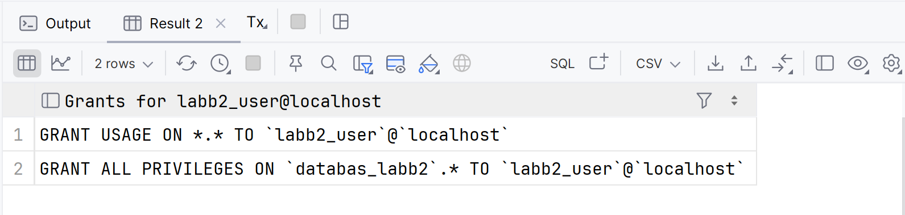

*Figur 1. Kontroll av användarbehörigheter i MySQL.*

---

## 2. Datamodellering

### 2.1 Entiteter

Utifrån verksamhetsbeskrivningen identifierade jag följande
entiteter och en tillhörande kopplingstabell:

| Entitet / tabell      | Beskrivning                                      |
|-----------------------|--------------------------------------------------|
| `employee`            | Företagets anställda                             |
| `department`          | Företagets avdelningar                           |
| `access_card`         | Anställdas passerkort                            |
| `competence`          | Registrerade kompetenser                         |
| `employee_competence` | Kopplingstabell mellan anställda och kompetenser |

### 2.2 Attribut

Attributen identifierades utifrån verksamhetens informationsbehov.

| Entitet / tabell      | Attribut                                            |
|-----------------------|-----------------------------------------------------|
| `employee`            | Förnamn, efternamn, e-postadress, anställningsdatum |
| `department`          | Avdelningsnamn, kontorsort                          |
| `access_card`         | Kortnummer, utfärdandedatum, giltighetsdatum        |
| `competence`          | Kompetensnamn, beskrivning                          |
| `employee_competence` | Anställdens ID, kompetensens ID                     |

Jag har valt att undvika redundant information, exempelvis
att lagra avdelningsnamnet direkt i `employee` eller antalet
anställda i `department`.

### 2.3 Relationer och kardinalitet

| Relation              | Kardinalitet | Beskrivning                                                                             |
|-----------------------|--------------|-----------------------------------------------------------------------------------------|
| Avdelning – Anställd  | 1:N          | En avdelning kan ha 0..N anställda. En anställd måste tillhöra exakt en avdelning.      |
| Anställd – Passerkort | 1:1          | En anställd kan ha 0..1 passerkort. Ett passerkort måste tillhöra exakt en anställd.    |
| Anställd – Kompetens  | M:N          | En anställd kan ha 0..N kompetenser. En kompetens kan vara kopplad till 0..N anställda. |

Många-till-många-relationen mellan anställda och kompetenser
hanteras genom kopplingstabellen `employee_competence`,
som delar upp relationen i två 1:N-relationer.

### 2.4 Nycklar, datatyper och begränsningar

| Tabell                  | Kolumn             | Datatyp      | Begränsningar                 |
|-------------------------|--------------------|--------------|-------------------------------|
| **employee**            | employee_id        | INT          | PK, AUTO_INCREMENT            |
|                         | first_name         | VARCHAR(30)  | NOT NULL                      |
|                         | last_name          | VARCHAR(30)  | NOT NULL                      |
|                         | email              | VARCHAR(75)  | NOT NULL, UNIQUE              |
|                         | employment_date    | DATE         | NOT NULL                      |
|                         | department_id      | INT          | FK, NOT NULL                  |
| **department**          | department_id      | INT          | PK, AUTO_INCREMENT            |
|                         | department_name    | VARCHAR(30)  | NOT NULL                      |
|                         | office_location    | VARCHAR(30)  | NOT NULL                      |
| **access_card**         | access_card_id     | INT          | PK, AUTO_INCREMENT            |
|                         | access_card_number | INT          | NOT NULL, UNIQUE              |
|                         | issuance_date      | DATE         | NOT NULL                      |
|                         | expiry_date        | DATE         | NOT NULL                      |
|                         | employee_id        | INT          | FK, NOT NULL, UNIQUE          |
| **competence**          | competence_id      | INT          | PK, AUTO_INCREMENT            |
|                         | competence_name    | VARCHAR(75)  | NOT NULL, UNIQUE              |
|                         | description        | VARCHAR(500) | NOT NULL                      |
| **employee_competence** | employee_id        | INT          | PK (sammansatt), FK, NOT NULL |
|                         | competence_id      | INT          | PK (sammansatt), FK, NOT NULL |

**Motivering av modellens designval:**

- **Primärnycklar:** Numeriska ID:n identifierar varje post entydigt.
  `AUTO_INCREMENT` genererar automatiskt nya ID-värden.

- **Datatyper:** `INT` används för ID:n och kortnummer,
  `VARCHAR` för text och `DATE` för datum utan klockslag.

- **Avdelningar:** `NOT NULL` och `FOREIGN KEY` på
  `employee.department_id` säkerställer att varje anställd
  tillhör en befintlig avdelning.

- **Passerkort:** `NOT NULL`, `FOREIGN KEY` och `UNIQUE` på
  `access_card.employee_id` säkerställer att varje passerkort
  tillhör en befintlig anställd och att ingen anställd kan
  ha flera registrerade passerkort.

- **Kompetenser:** En sammansatt primärnyckel bestående av
  `employee_id` och `competence_id` i `employee_competence`
  förhindrar dubbla kompetenskopplingar. Båda kolumnerna är
  även främmande nycklar.

- **Unika värden:** `UNIQUE` förhindrar dubblerade
  e-postadresser, kortnummer och kompetensnamn.

### 2.5 Färdig datamodell

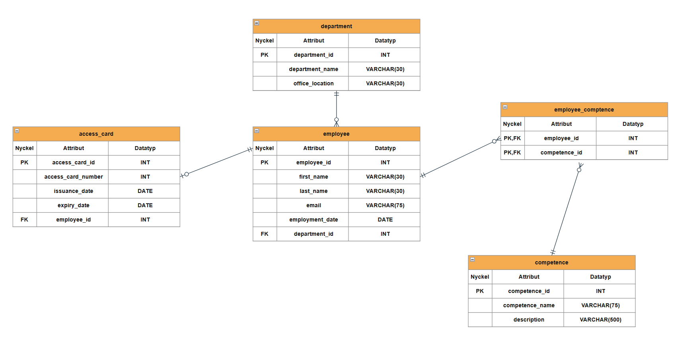

*Figur 2. Personalregistrets datamodell.*

ER-diagrammet visar tabeller, attribut, datatyper, primärnycklar,
främmande nycklar och relationernas kardinalitet. Övriga
begränsningar framgår av tabellen i avsnitt 2.4.

## 3. SQL-implementation och testdata

### 3.1 SQL-filer

| SQL-fil                                                | Innehåll                                                           |
|--------------------------------------------------------|--------------------------------------------------------------------|
| [root.sql](SQL-files/root.sql)                         | Skapar databasen och användaren samt tilldelar behörigheter.       |
| [personalregister.sql](SQL-files/personalregister.sql) | Skapar tabeller, registrerar testdata och innehåller SQL-frågorna. |

Tabellerna skapades i följande ordning utifrån deras beroenden:

`department` → `employee` → `access_card` → `competence` → `employee_competence`

Refererade tabeller måste finnas innan främmande nycklar
som hänvisar till dem kan skapas.

### 3.2 Testdata

Databasen innehåller följande fiktiva testdata:

| Tabell                | Antal poster |
|-----------------------|-------------:|
| `department`          |           10 |
| `employee`            |           50 |
| `access_card`         |           25 |
| `competence`          |           68 |
| `employee_competence` |          153 |

Testdatan är utformad för att täcka följande situationer:

- Flera anställda på samma avdelning.
- Anställda fördelade mellan olika avdelningar.
- Två avdelningar utan anställda: Juridik och Kvalitetssäkring.
- 25 anställda med och 25 utan passerkort.
- Anställda med flera kompetenser.
- Kompetenser som delas av flera anställda.
- Fem anställda utan registrerade kompetenser.
- Fyra kompetenser utan kopplade anställda.
- Anställda med identiska namn men olika e-postadresser.

> [!NOTE]
**Användning av AI**
ChatGPT användes för att generera fiktiv testdata, inklusive namn, avdelningar, kompetenser och beskrivningar.
Jag har själv kontrollerat att testdatan följer databasens relationer och begränsningar.

---

## 4. SQL-frågor

> [!NOTE]
**Användning av AI**
Jag har använt ChatGPT som stöd för att skapa HTML-koden till tabellerna i min Markdown-dokumentation. Syftet var att
kunna presentera skärmdumpar och GIF-animationer tillsammans med tillhörande beskrivningar på ett tydligt och enhetligt
sätt.
AI har hjälpt mig med tabellernas struktur, bildstorlekar, länkar till originalfilerna och formateringen. Jag har själv
valt vilket material som ska visas, anpassat beskrivningarna och kontrollerat hur tabellerna presenteras i Markdown och
på GitHub.

### 4.1 G1 Anställda med avdelning (INNER JOIN)

**Syfte:** Visa anställdas förnamn, efternamn och avdelningsnamn.

**SQL-fråga:** [Anställda med avdelning](SQL-files/personalregister.sql#L437-L443)

```sql
SELECT e.first_name, e.last_name, d.department_name
FROM employee e
         INNER JOIN department d
                    ON e.department_id = d.department_id;
```

<table>
  <tr>
    <td width="620" valign="top">
      <a href="pictures/G1.png">
        
      </a>
    </td>
    <td valign="top">
      <strong>Figur 3. Resultat och förklaring</strong>
      <p>
        <code>INNER JOIN</code> kopplar samman tabellerna
        <code>employee</code> och <code>department</code>
        genom att jämföra den främmande nyckeln
        <code>employee.department_id</code> med primärnyckeln
        <code>department.department_id</code>. När värdena
        matchar kopplas den anställde till rätt avdelning.
      </p>
      <p>
        Jag har valt <code>INNER JOIN</code> eftersom frågan
        endast ska visa anställda och deras tillhörande
        avdelningar.
      </p>
      <p>
        Resultatet innehåller 50 rader med anställdas förnamn,
        efternamn och avdelningsnamn. Samtliga anställda visas
        eftersom databasens begränsningar säkerställer att
        varje anställd tillhör en befintlig avdelning.
      </p>
      <p>
        Avdelningarna Juridik och Kvalitetssäkring visas inte
        eftersom de saknar matchande anställda och
        <code>INNER JOIN</code> kräver en matchning mellan
        tabellerna.
      </p>
      <p>
        <em>Klicka på bilden för att visa den i full storlek.</em>
      </p>
    </td>
  </tr>
</table>

### 4.2 G2 Alla avdelningar med anställda (LEFT JOIN)

**Syfte:** Visa alla avdelningar och deras anställda,
även avdelningar utan personal.

**SQL-fråga:** [Alla avdelningar med anställda](SQL-files/personalregister.sql#L445-L453)

```sql
SELECT d.department_name,
       CONCAT(e.first_name, ' ', e.last_name) AS full_name
FROM department d
         LEFT JOIN employee e
                   ON e.department_id = d.department_id;
```

<table>
  <tr>
    <td width="620" valign="top">
      <a href="pictures/G2.png">
        
      </a>
    </td>
    <td valign="top">
      <strong>Figur 4. Resultat och förklaring</strong>
      <p>
        <code>LEFT JOIN</code> kopplar samman tabellerna
        <code>department</code> och <code>employee</code>
        genom att jämföra primärnyckeln
        <code>department.department_id</code> med den
        främmande nyckeln <code>employee.department_id</code>.
      </p>
      <p>
        Jag har valt <code>LEFT JOIN</code> eftersom frågan
        ska visa samtliga avdelningar, oavsett om de har
        registrerade anställda eller inte. Därför används
        <code>department</code> som vänster tabell.
      </p>
      <p>
        Resultatet innehåller 52 rader: 50 rader som
        representerar anställda och två rader som
        representerar avdelningar utan personal.
      </p>
      <p>
        Avdelningarna Juridik och Kvalitetssäkring finns
        kvar i resultatet, men visas med <code>NULL</code>
        i kolumnen <code>full_name</code> eftersom det
        saknas matchande anställda.
      </p>
      <p>
        Funktionen <code>CONCAT()</code> används för att
        sammanfoga förnamn och efternamn till ett
        fullständigt namn i en gemensam kolumn.
      </p>
      <p>
        <em>Klicka på bilden för att visa den i full storlek.</em>
      </p>
    </td>
  </tr>
</table>

### 4.3 VG1 Anställda med avdelning och eventuellt passerkort

**Syfte:** Visa samtliga anställda med deras tillhörande
avdelningar och eventuella passerkort, även anställda
som saknar passerkort.

**SQL-fråga:** [Anställda med avdelning och passerkort](SQL-files/personalregister.sql#L455-L466)

```sql
SELECT d.department_name,
       a.access_card_number,
       CONCAT(e.first_name, ' ', e.last_name) AS full_name
FROM employee e
         INNER JOIN department d
                    ON e.department_id = d.department_id
         LEFT JOIN access_card a
                   ON e.employee_id = a.employee_id;
```

<table>
  <tr>
    <td width="620" valign="top">
      <a href="pictures/VG1.png">
        
      </a>
    </td>
    <td valign="top">
      <strong>Figur 5. Resultat och förklaring</strong>
      <p>
        <code>INNER JOIN</code> kopplar samman tabellerna
        <code>employee</code> och <code>department</code>
        genom deras gemensamma <code>department_id</code>.
        Jag har valt denna JOIN-typ eftersom varje anställd
        måste tillhöra en befintlig avdelning.
      </p>
      <p>
        Därefter används <code>LEFT JOIN</code> för att
        koppla anställda till <code>access_card</code>
        genom att jämföra primärnyckeln
        <code>employee.employee_id</code> med den främmande
        nyckeln <code>access_card.employee_id</code>.
      </p>
      <p>
        Eftersom relationen till passerkort är valfri
        används <code>LEFT JOIN</code> för att behålla
        samtliga anställda, även de som saknar passerkort.
      </p>
      <p>
        Resultatet innehåller 50 rader. De 25 anställda
        som har passerkort visas med sina kortnummer,
        medan resterande 25 visas med <code>NULL</code>
        i kolumnen <code>access_card_number</code>.
      </p>
      <p>
        Varje anställd visas endast en gång eftersom
        <code>UNIQUE</code> på
        <code>access_card.employee_id</code> säkerställer
        att en anställd kan ha högst ett passerkort.
      </p>
      <p>
        <em>Klicka på bilden för att visa den i full storlek.</em>
      </p>
    </td>
  </tr>
</table>

### 4.4 VG2 Avdelningar med anställda och eventuella passerkort

**Syfte:** Visa samtliga avdelningar, deras anställda och
eventuella passerkort, inklusive avdelningar utan anställda
och anställda utan passerkort.

**SQL-fråga:** [Avdelningar med anställda och passerkort](SQL-files/personalregister.sql#L467)

```sql
SELECT d.department_name,
       a.access_card_number,
       CONCAT(e.first_name, ' ', e.last_name) AS full_name
FROM department d
         LEFT JOIN employee e
                   ON e.department_id = d.department_id
         LEFT JOIN access_card a
                   ON e.employee_id = a.employee_id;
```

<table>
  <tr>
    <td width="620" valign="top">
      <a href="pictures/VG2.png">
        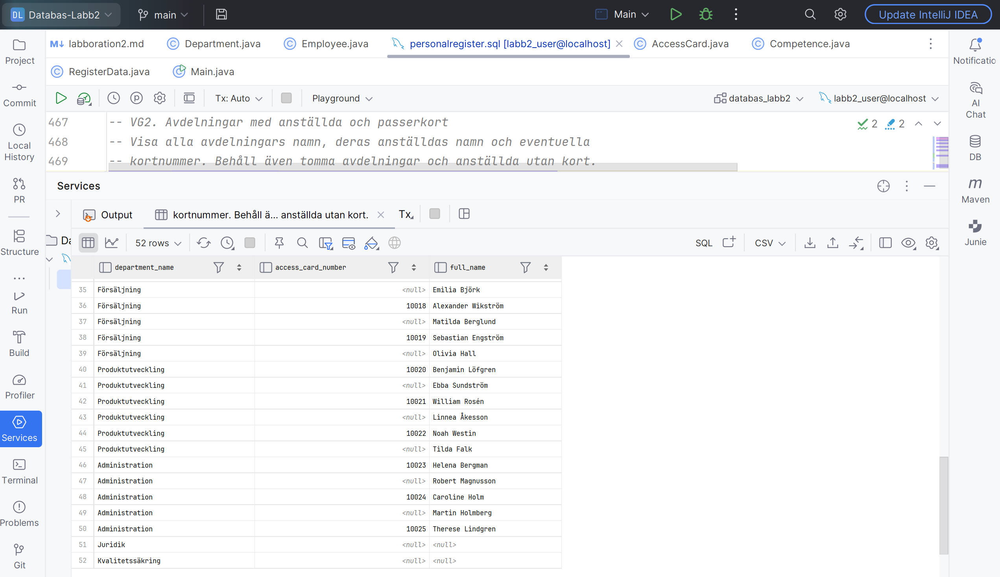
      </a>
    </td>
    <td valign="top">
      <strong>Figur 6. Resultat och förklaring</strong>
      <p>
        Frågan utgår från <code>department</code> och
        använder två <code>LEFT JOIN</code> för att
        behålla samtliga avdelningar, även när anställda
        eller passerkort saknas.
      </p>
      <p>
        Den första kopplingen hämtar anställda genom
        att jämföra primärnyckeln
        <code>department.department_id</code> med den
        främmande nyckeln <code>employee.department_id</code>.
      </p>
      <p>
        Den andra kopplingen hämtar eventuella passerkort
        genom att jämföra <code>employee.employee_id</code>
        med <code>access_card.employee_id</code>.
        Anställda utan passerkort behålls eftersom även
        denna koppling använder <code>LEFT JOIN</code>.
      </p>
      <p>
        Resultatet innehåller 52 rader: 25 anställda med
        passerkort, 25 anställda utan passerkort och två
        avdelningar utan anställda.
      </p>
      <p>
        Juridik och Kvalitetssäkring visas med
        <code>NULL</code> i både <code>full_name</code>
        och <code>access_card_number</code>. Anställda
        utan passerkort visas däremot med sitt namn,
        men med <code>NULL</code> som kortnummer.
      </p>
      <p>
        Resultatet visar därmed hur flera valfria
        kopplingar kan hanteras i samma SQL-fråga
        utan att information om avdelningar eller
        anställda går förlorad.
      </p>
      <p>
        <em>Klicka på bilden för att visa den i full storlek.</em>
      </p>
    </td>
  </tr>
</table>

### 4.5 VG3 En anställds samlade uppgifter

**Syfte:** Hämta en anställds person- och anställningsuppgifter,
avdelningsuppgifter, eventuellt passerkort samt samtliga
registrerade kompetenser med tillhörande beskrivningar.

**SQL-fråga:** [En anställds samlade uppgifter](SQL-files/personalregister.sql#L479)

```sql
SELECT e.employee_id,
       e.employment_date,
       e.email,
       d.department_id,
       d.department_name,
       d.office_location,
       a.access_card_id,
       COALESCE(
               CAST(a.access_card_number AS CHAR),
               'Inget passerkort registrerat'
       )                                      AS access_card,
       a.issuance_date,
       a.expiry_date,
       CONCAT(e.first_name, ' ', e.last_name) AS full_name,
       COALESCE(
               CONCAT(c.competence_id, ' ', c.competence_name, ': ', c.description),
               'Inga kompetenser registrerade för den anställde'
       )                                      AS competences
FROM employee e
         INNER JOIN department d
                    ON e.department_id = d.department_id
         LEFT JOIN access_card a
                   ON e.employee_id = a.employee_id
         LEFT JOIN employee_competence ec
                   ON e.employee_id = ec.employee_id
         LEFT JOIN competence c
                   ON ec.competence_id = c.competence_id
WHERE e.employee_id = 1;
```

**Förklaring av SQL-frågan**

Jag använder `INNER JOIN` för att hämta den anställdes
avdelningsuppgifter eftersom varje anställd måste tillhöra
en befintlig avdelning.

För de valfria relationerna till passerkort och kompetenser
använder jag `LEFT JOIN`. Kompetenserna hämtas genom
kopplingstabellen `employee_competence`, som hanterar
många-till-många-relationen.

`CONCAT()` sammanfogar relaterade värden i gemensamma
resultatkolumner. `COALESCE()` ersätter vissa NULL-värden
med förklarande texter, medan `CAST()` omvandlar kortnumret
från heltal till text.

För att kontrollera de valfria relationerna kör jag samma
SQL-fråga för fyra olika anställda genom att ändra
`employee_id` i WHERE-villkoret.

<table>
  <tr>
    <td width="620" valign="top">
      <a href="pictures/VG3.png">
        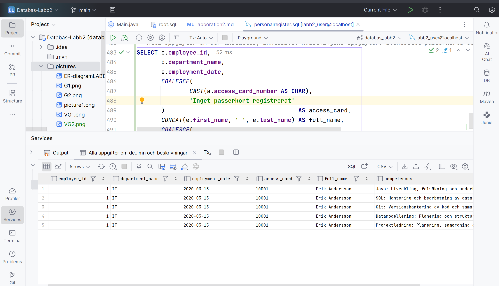
      </a>
    </td>
    <td valign="top">
      <strong>Figur 7. Anställd med passerkort och kompetenser</strong>
      <p>
        <strong>Erik Andersson – employee_id = 1</strong>
      </p>
      <p>
        Resultatet innehåller fem rader eftersom Erik har
        fem registrerade kompetenser: Java, SQL, Git,
        Datamodellering och Projektledning.
      </p>
      <p>
        Varje kompetenskoppling ger en egen resultatrad.
        Personuppgifterna, avdelningsuppgifterna och
        passerkortets uppgifter upprepas därför på varje rad.
        Det innebär inte att den anställde är registrerad
        flera gånger i databasen.
      </p>
      <p>
        <em>Klicka på bilden för att visa den i full storlek.</em>
      </p>
    </td>
  </tr>
  <tr>
    <td width="620" valign="top">
      <a href="pictures/VG3-2.png">
        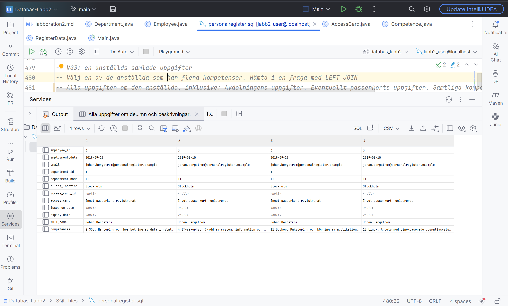
      </a>
    </td>
    <td valign="top">
      <strong>Figur 8. Anställd utan passerkort</strong>
      <p>
        <strong>Johan Bergström – employee_id = 3</strong>
      </p>
      <p>
        Resultatet innehåller fyra rader som motsvarar
        Johans fyra registrerade kompetenser.
      </p>
      <p>
        Trots att Johan saknar passerkort behålls hans
        uppgifter genom <code>LEFT JOIN</code>.
        Passerkortets ID och datum visas som
        <code>NULL</code>, medan kortnumret ersätts
        med texten <em>Inget passerkort registrerat</em>
        genom <code>COALESCE()</code>.
      </p>
      <p>
        <em>Klicka på bilden för att visa den i full storlek.</em>
      </p>
    </td>
  </tr>
  <tr>
    <td width="620" valign="top">
      <a href="pictures/VG3-3.png">
        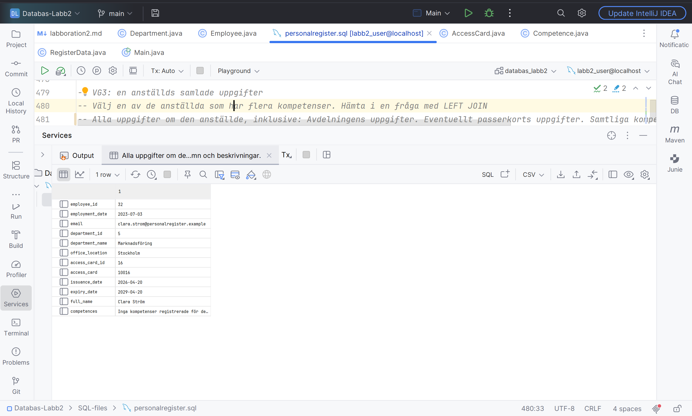
      </a>
    </td>
    <td valign="top">
      <strong>Figur 9. Anställd utan kompetenser</strong>
      <p>
        <strong>Clara Ström – employee_id = 32</strong>
      </p>
      <p>
        Resultatet innehåller en rad med Claras
        personuppgifter, avdelningsuppgifter och passerkort.
      </p>
      <p>
        Eftersom Clara saknar kopplingar i
        <code>employee_competence</code> finns inga
        matchande kompetenser. Genom <code>LEFT JOIN</code>
        behålls ändå den anställde i resultatet.
        <code>COALESCE()</code> visar ett förklarande
        meddelande i kompetenskolumnen.
      </p>
      <p>
        <em>Klicka på bilden för att visa den i full storlek.</em>
      </p>
    </td>
  </tr>
  <tr>
    <td width="620" valign="top">
      <a href="pictures/VG3-4.png">
        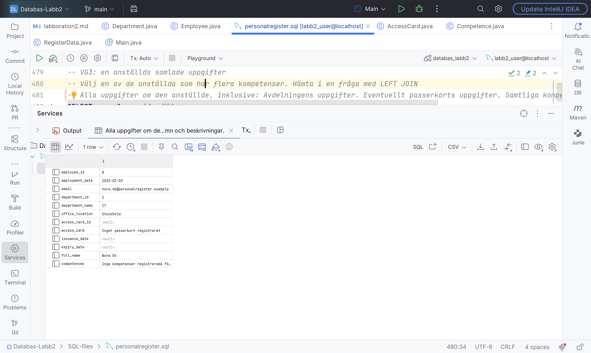
      </a>
    </td>
    <td valign="top">
      <strong>Figur 10. Anställd utan passerkort och kompetenser</strong>
      <p>
        <strong>Nora Ek – employee_id = 8</strong>
      </p>
      <p>
        Resultatet innehåller en rad med Noras
        personuppgifter och avdelningsuppgifter,
        trots att både passerkort och registrerade
        kompetenser saknas.
      </p>
      <p>
        Testet visar att båda valfria relationerna
        kan saknas samtidigt utan att den anställde
        försvinner ur resultatet. Förklarande texter
        visas genom <code>COALESCE()</code>.
      </p>
      <p>
        <em>Klicka på bilden för att visa den i full storlek.</em>
      </p>
    </td>
  </tr>
</table>

**Slutsats**

Testfallen visar att många-till-många-relationen kan ge
flera resultatrader för samma anställd och att LEFT JOIN
behåller den anställde även när en eller båda de valfria
relationerna saknas.

### 4.6 VG4 Jämförelse mellan INNER JOIN och LEFT JOIN

**Syfte:** Undersöka hur valet av JOIN-typ påverkar
resultatet när det finns avdelningar utan anställda.

**SQL-frågor:** [Jämförelse mellan INNER JOIN och LEFT JOIN](SQL-files/personalregister.sql#L598)

**INNER JOIN**

```sql
SELECT d.department_name,
       CONCAT(e.first_name, ' ', e.last_name) AS full_name
FROM department d
         INNER JOIN employee e
                    ON e.department_id = d.department_id;
```

**LEFT JOIN**

```sql
SELECT d.department_name,
       CONCAT(e.first_name, ' ', e.last_name) AS full_name
FROM department d
         LEFT JOIN employee e
                   ON e.department_id = d.department_id;
```

Båda frågorna utgår från tabellen `department` och kopplar
samman avdelningar och anställda genom `department_id`.
Den enda skillnaden mellan frågorna är vilken JOIN-typ
som används.

<table>
  <tr>
    <td width="620" valign="top">
      <a href="pictures/VG4-1.png">
        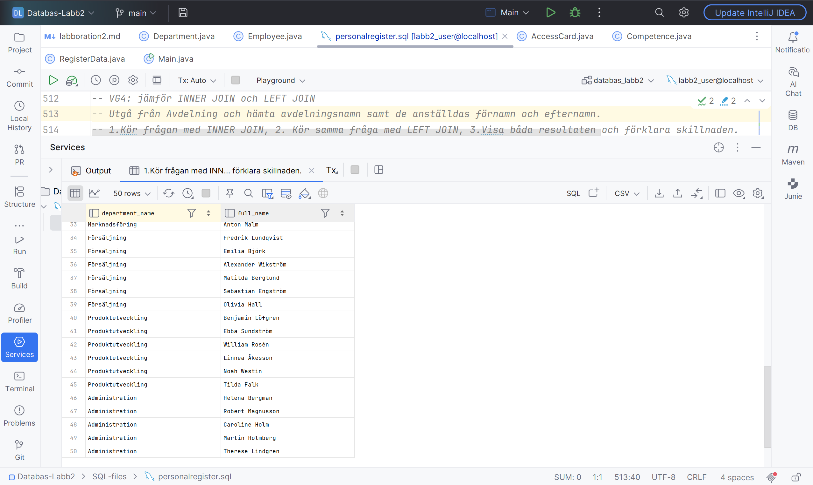
      </a>
    </td>
    <td valign="top">
      <strong>Figur 11. Resultat med INNER JOIN</strong>
      <p>
        Resultatet innehåller 50 rader och visar endast
        avdelningar som har registrerade anställda.
      </p>
      <p>
        Avdelningarna Juridik och Kvalitetssäkring
        försvinner eftersom det inte finns några rader
        i <code>employee</code> vars
        <code>department_id</code> matchar dessa
        avdelningars primärnycklar.
      </p>
      <p>
        Detta beror på att <code>INNER JOIN</code>
        kräver en matchning mellan tabellerna.
      </p>
      <p>
        <em>Klicka på bilden för att visa den i full storlek.</em>
      </p>
    </td>
  </tr>
  <tr>
    <td width="620" valign="top">
      <a href="pictures/VG4-2.png">
        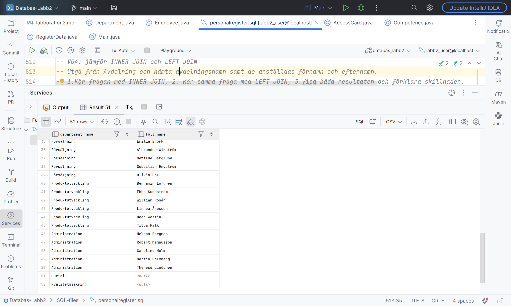
      </a>
    </td>
    <td valign="top">
      <strong>Figur 12. Resultat med LEFT JOIN</strong>
      <p>
        Resultatet innehåller 52 rader eftersom
        <code>LEFT JOIN</code> behåller samtliga
        avdelningar från den vänstra tabellen,
        även när matchande anställda saknas.
      </p>
      <p>
        Juridik och Kvalitetssäkring finns därför kvar
        i resultatet. Deras avdelningsnamn visas,
        medan kolumnen <code>full_name</code>
        innehåller <code>NULL</code>.
      </p>
      <p>
        <code>NULL</code> innebär här att ett
        matchande värde saknas, inte att värdet
        är noll eller en tom textsträng.
      </p>
      <p>
        <em>Klicka på bilden för att visa den i full storlek.</em>
      </p>
    </td>
  </tr>
  <tr>
    <td width="620" valign="top">
      <a href="pictures/VG4_Inner_Left_Join.gif">
        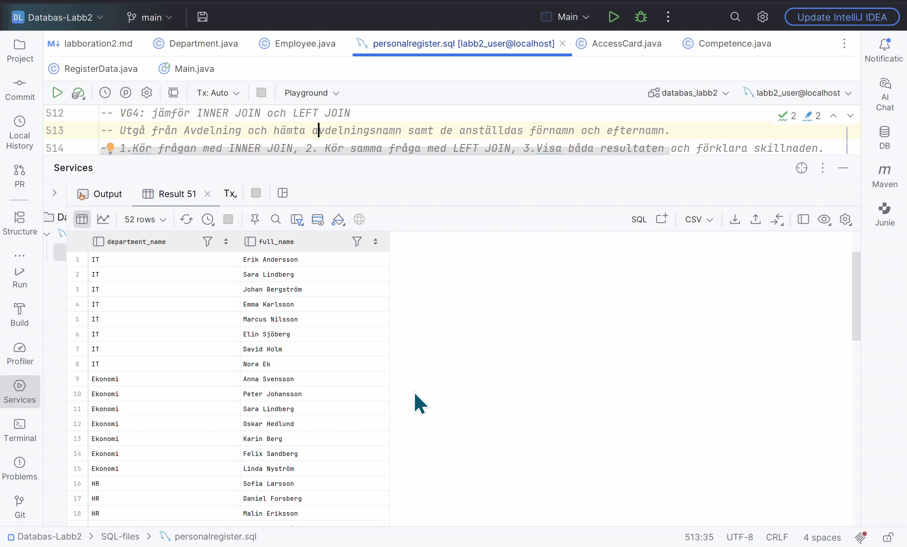
      </a>
    </td>
    <td valign="top">
      <strong>Figur 13. Praktisk demonstration</strong>
      <p>
        Animationen visar genomförandet av båda
        SQL-frågorna och hur resultatet förändras
        när <code>INNER JOIN</code> ersätts med
        <code>LEFT JOIN</code>.
      </p>
      <p>
        Skillnaden på två resultatrader motsvarar
        avdelningarna som saknar anställda.
      </p>
      <p>
        <em>Öppna GIF-filen i en webbläsare för att
        visa animationen i originalstorlek.</em>
      </p>
    </td>
  </tr>
</table>

**Slutsats**

Valet av JOIN-typ beror på vilken information som ska
hämtas. `INNER JOIN` är lämplig när endast matchande
poster ska visas. `LEFT JOIN` är lämplig när samtliga
poster från den vänstra tabellen ska behållas,
även om motsvarande uppgifter saknas.

---

## 5. Java-modell

### 5.1 Modellklasser

Java-applikationen består av fyra modellklasser som motsvarar
databasens entiteter samt två klasser för hantering av testdata
och körning av programmet.

| Java-klass     | Motsvarande tabell | Ansvarsområde                                                                                 |
|----------------|--------------------|-----------------------------------------------------------------------------------------------|
| `Department`   | `department`       | Avdelnings-ID, avdelningsnamn och kontorsort.                                                 |
| `Employee`     | `employee`         | Person- och anställningsuppgifter samt relationer till avdelning, passerkort och kompetenser. |
| `AccessCard`   | `access_card`      | Passerkorts-ID, kortnummer, utfärdandedatum, giltighetsdatum och kortets innehavare.          |
| `Competence`   | `competence`       | Kompetens-ID, kompetensnamn och beskrivning.                                                  |
| `RegisterData` | –                  | Skapar, lagrar och kopplar samman testobjekten.                                               |
| `Main`         | –                  | Startar programmet och presenterar personalregistrets information i konsolen.                 |

### 5.2 Relationer i Java

I Java representeras databasens relationer genom
objektreferenser i stället för främmande nycklar.

| Relation                    | Representation i Java          | Motivering                                                                                  |
|-----------------------------|--------------------------------|---------------------------------------------------------------------------------------------|
| Avdelning – Anställd (1:N)  | `Department department`        | Flera anställda kan referera till samma avdelningsobjekt.                                   |
| Anställd – Passerkort (1:1) | `AccessCard accessCard`        | En anställd kan referera till ett passerkort eller sakna ett.                               |
| Anställd – Kompetens (M:N)  | `List<Competence> competences` | En anställd kan referera till flera kompetensobjekt, som även kan delas av andra anställda. |

**Avdelningar**

Varje anställd får en referens till ett befintligt
`Department`-objekt när den skapas. Genom `getDepartment()`
kan jag komma åt avdelningens uppgifter.

**Passerkort**

Relationen till passerkort är valfri. Om en anställd saknar
passerkort är fältet `accessCard` lika med `null`.
Klassen `AccessCard` innehåller även en referens tillbaka
till `Employee`, vilket gör relationen dubbelriktad.

**Kompetenser**

Jag valde `List<Competence>` eftersom en anställd kan ha
flera kompetenser eller sakna kompetenser helt.

Kompetensobjekten skapas separat och kan delas mellan
flera anställda. Exempelvis refererar både Erik Andersson
och Johan Bergström till samma kompetensobjekt för SQL.

Listan med objektreferenser representerar den relation
som i databasen hanteras genom kopplingstabellen
`employee_competence`. Därför behövs ingen separat
Java-klass för kopplingstabellen.

### 5.3 Testdata och objekthantering

Java-applikationen använder ett urval av databasens
fiktiva testdata.

| Entitet     | Databas | Java-applikation |
|-------------|--------:|-----------------:|
| Avdelningar |      10 |               10 |
| Anställda   |      50 |               15 |
| Passerkort  |      25 |                7 |
| Kompetenser |      68 |               34 |

I `RegisterData` används följande datastrukturer för att
lagra och hämta objekt med hjälp av deras ID:

- `Map<Integer, Department>`
- `Map<Integer, Employee>`
- `Map<Integer, Competence>`

Avdelningar skapas innan anställda, och kompetensobjekten
skapas innan de tilldelas anställda. På så sätt kan
relationerna representeras genom referenser till
befintliga objekt.

Testdatan omfattar även:

- Anställda med och utan passerkort.
- Anställda med flera eller inga kompetenser.
- Kompetensobjekt som delas mellan flera anställda.
- Kompetenser utan kopplade anställda: AI-utveckling,
  Blockchain och Robotprocessautomatisering (RPA).

### 5.4 Konsolutskrifter

I `Main` används en for-each-loop för att gå igenom
samtliga anställda och skriva ut deras uppgifter.

Om passerkortet är `null` eller kompetenslistan är tom
visas ett förklarande meddelande.

<table>
  <tr>
    <td width="620" valign="top">
      <a href="pictures/JavaResult2.png">
        
      </a>
    </td>
    <td valign="top">
      <strong>Figur 14. Konsolutskrift – del 1</strong>
      <p>
        Programmet visar anställnings-ID, namn,
        mejladress och anställningsdatum samt
        tillhörande avdelning, eventuellt passerkort
        och registrerade kompetenser.
      </p>
      <p>
        Utskriften demonstrerar hur information från
        flera modellklasser kan hämtas genom den
        anställdes objektreferenser.
      </p>
      <p>
        <em>Klicka på bilden för att visa den i full storlek.</em>
      </p>
    </td>
  </tr>
  <tr>
    <td width="620" valign="top">
      <a href="pictures/JavaResult3.png">
        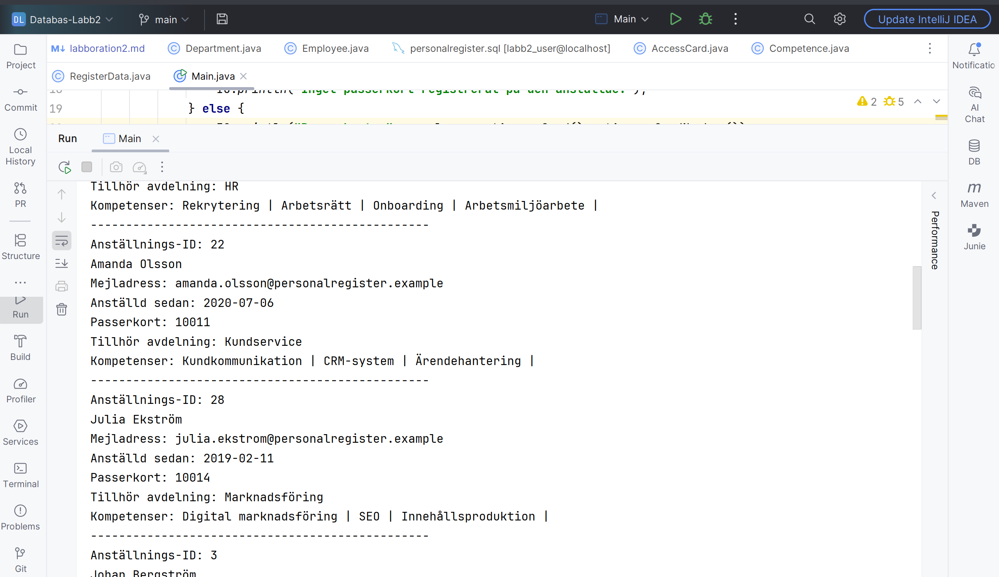
      </a>
    </td>
    <td valign="top">
      <strong>Figur 15. Konsolutskrift – del 2</strong>
      <p>
        Fortsättning av konsolutskriften med
        ytterligare anställda och deras relationer.
      </p>
      <p>
        Programmet kan även hantera anställda som
        saknar passerkort eller registrerade
        kompetenser utan att dessa personer
        utelämnas från utskriften.
      </p>
      <p>
        <em>Klicka på bilden för att visa den i full storlek.</em>
      </p>
    </td>
  </tr>
  <tr>
    <td width="620" valign="top">
      <a href="pictures/JavaResult.gif">
        
      </a>
    </td>
    <td valign="top">
      <strong>Figur 16. Fullständig programdemonstration</strong>
      <p>
        GIF-animationen visar konsolutskriften
        för samtliga 15 anställda och demonstrerar
        hur Java-modellen representerar relationerna
        mellan anställda, avdelningar, passerkort
        och kompetenser.
      </p>
      <p>
        <em>Öppna GIF-filen i en webbläsare för att
        visa animationen i originalstorlek.</em>
      </p>
    </td>
  </tr>
</table>

### 5.5 Så körs programmet

1. Öppna projektet i IntelliJ IDEA.
2. Öppna klassen `Main.java`.
3. Kör programmets `main()`-metod.
4. Resultatet visas i konsolen.

Programmet använder objekt som skapas direkt i Java-koden
och kräver därför ingen aktiv databasanslutning.

---
