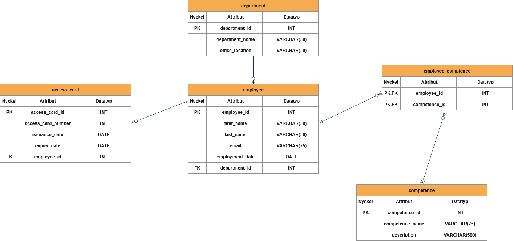
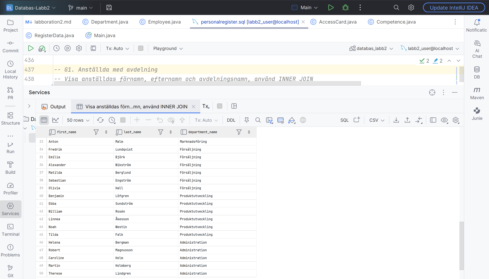

# Laboration 2 – Företagets personalregister

## 1. Projektöversikt

**Projekt:** `databas_labb2`  
**Databas:** `databas_labb2`  
**Databasanvändare:** `labb2_user` (lösenord dokumenteras genom 'Platshållare')

### 1.1 Databas och behörigheter

```sql
SELECT CURRENT_USER();
CREATE DATABASE databas_labb2;

CREATE USER 'labb2_user'@'localhost'
    IDENTIFIED BY 'PLATSHÅLLARE';

GRANT ALL PRIVILEGES
    ON databas_labb2.*
    TO 'labb2_user'@'localhost';

SHOW GRANTS FOR 'labb2_user'@'localhost';
```

```sql
SELECT CURRENT_USER(), DATABASE();
SHOW GRANTS; 
```

*Jag kontrollerade databasanslutningen i IntelliJ genom att köra `SELECT CURRENT_USER();` för att verifiera att jag
var ansluten som `labb2_user@localhost`.
Därefter använde jag `SELECT DATABASE();` för att kontrollera att den aktiva databasen var `databas_labb2`.
Slutligen körde jag `SHOW GRANTS;` för att kontrollera användarens behörigheter. Resultatet visade att `labb2_user` har
behörigheter inom `databas_labb2`, men inga globala databasbehörigheter.*


*Figur 1. Kontroll av användarbehörigheter i MySQL. Resultatet visar att labb2_user har fullständiga behörigheter till
databasen databas_labb2, men inga motsvarande globala behörigheter till övriga databaser.*

---

## 2. Datamodellering

### 2.1 Identifierade entiteter

| Entitet                 | Vad representerar den?                            | Varför behövs den?                                                                                                   |
|-------------------------|---------------------------------------------------|----------------------------------------------------------------------------------------------------------------------|
| **employee**            | *Företagets anställda*                            | För att hålla reda på alla anställda inom företaget.                                                                 |
| **department**          | *Företagets olika avdelningar*                    | För att registrera företagets avdelningar och kunna koppla anställda till rätt avdelning.                            |
| **access_card**         | *Passerkort som anställda kan få/ha*              | För att hålla reda på de passerkort som har getts ut.                                                                |
| **competence**          | *Kompetenser som Java, SQL och projektledning.*   | För att registrera vilka kompetenser som finns och deras beskrivningar, även om ingen anställd har kompetensen ännu. |
| **employee_competence** | *Kopplingen mellan en anställd och en kompetens.* | För att en anställd ska kunna ha flera kompetenser och samma kompetens kunna tillhöra flera anställda.               |

### 2.2 Attribut

| Entitet                 | Attribut             | Vad lagras?                       | Obligatoriskt? | Unikt?            |
|-------------------------|----------------------|-----------------------------------|----------------|-------------------|
| **employee**            | *employee_id*        | Unikt ID för den anställde        | Ja             | Ja                |
|                         | *first_name*         | Förnamn                           | Ja             | Nej               |
|                         | *last_name*          | Efternamn                         | Ja             | Nej               |
|                         | *email*              | E-postadress                      | Ja             | Ja                |
|                         | *employment_date*    | Anställningsdatum                 | Ja             | Nej               |
|                         | *department_id*      | ID för den anställdes avdelning   | Ja             | Nej               |
| **department**          | *department_id*      | Unikt ID för avdelningen          | Ja             | Ja                |
|                         | *department_name*    | Avdelningens namn                 | Ja             | Nej               |
|                         | *office_location*    | Kontorsort                        | Ja             | Nej               |
| **access_card**         | *access_card_id*     | Unikt internt ID för passerkortet | Ja             | Ja                |
|                         | *access_card_number* | Unikt kortnummer                  | Ja             | Ja                |
|                         | *issuance_date*      | Utfärdandedatum                   | Ja             | Nej               |
|                         | *expiry_date*        | Sista giltighetsdatum             | Ja             | Nej               |
|                         | *employee_id*        | ID för kortets innehavare         | Ja             | Ja                |
| **competence**          | *competence_id*      | Unikt ID för kompetensen          | Ja             | Ja                |
|                         | *competence_name*    | Kompetensens namn                 | Ja             | Ja                |
|                         | *description*        | Beskrivning av kompetensen        | Ja             | Nej               |
| **employee_competence** | *employee_id*        | ID för den anställde              | Ja             | Nej, inte enskilt |
|                         | *competence_id*      | ID för kompetensen                | Ja             | Nej, inte enskilt |

**Samtliga attribut har valts som obligatoriska för respektive registrerad post. Det innebär däremot inte att alla
relationer är obligatoriska. En anställd behöver exempelvis inte ha något passerkort, men varje registrerat passerkort
måste tillhöra exakt en anställd. En avdelning kan också existera utan anställda.**

### 2.2.1 Tillvägagångssätt och reflektion kring attributval

Jag utgick från verksamhetsbeskrivningen för att identifiera vilka attribut som behövdes för respektive entitet. Under
arbetets gång justerade jag modellen för att undvika onödig eller upprepad information, exempelvis department_name i
employee och employee_count i department.

Jag valde datatyper och begränsningar utifrån verksamhetens krav och tog särskild hänsyn till vilka uppgifter som måste
vara obligatoriska eller unika. För VG utökade jag modellen med kompetenser och en kopplingstabell för att hantera
många-till-många-relationen.

### 2.3 Relationer och kardinalitet

| Entitet A           | Entitet B           | Kardinalitet | Obligatoriskt/valfritt | Motivering                                                             |
|---------------------|---------------------|--------------|------------------------|------------------------------------------------------------------------|
| department          | employee            | 0..N         | valfritt               | *En avdelning kan ha noll, en eller flera anställda*                   |
| employee            | department          | 1..1         | obligatoriskt          | *En anställd måste tillhöra exakt en avdelning.*                       |
| employee            | access_card         | 0..1         | valfritt               | *En anställd kan sakna passerkort eller ha högst ett.*                 |
| access_card         | employee            | 1..1         | obligatoriskt          | *Ett registrerat passerkort måste tillhöra exakt en anställd.*         |
| employee            | employee_competence | 0..N         | valfritt               | *En anställd kan ha flera kompetenskopplingar eller inga alls.*        |
| employee_competence | employee            | 1..1         | obligatoriskt          | *Varje koppling måste hänvisa till exakt en anställd.*                 |
| competence          | employee_competence | 0..N         | valfritt               | *En kompetens kan vara kopplad till flera anställda eller ingen alls.* |
| employee_competence | competence          | 1..1         | obligatoriskt          | *Varje koppling måste hänvisa till exakt en kompetens.*                |

Relationen mellan `employee` och `competence` är M:N. Kopplingstabellen `employee_competence` delar upp den i två 1:
N-relationer.

### 2.4 Nycklar, datatyper och begränsningar

| Tabell              | Kolumn             | Datatyp      | PK/FK   | Begränsningar   | Motivering                                                                                                                                                                                                                                                                                                                                        |
|---------------------|--------------------|--------------|---------|-----------------|---------------------------------------------------------------------------------------------------------------------------------------------------------------------------------------------------------------------------------------------------------------------------------------------------------------------------------------------------|
| employee            | employee_id        | INT          | PK      | AUTO_INCREMENT  | Varje anställd identifieras med ett numeriskt ID. PK eftersom varje anställd behöver kunna identifieras entydigt. Flera anställda kan ex. ha samma namn, men deras ID får aldrig vara samma. AUTO_INCREMENT så att MySQL tilldelar automatiskt nytt ID när en anställd registreras. NOT NULL behöver inte anges, då denna kolumn är primärnyckel. |
|                     | first_name         | VARCHAR(30)  |         | NOT NULL        | Förnamn lagras som text och måste anges.                                                                                                                                                                                                                                                                                                          |
|                     | last_name          | VARCHAR(30)  |         | NOT NULL        | Efternamn lagras som text och måste anges.                                                                                                                                                                                                                                                                                                        |
|                     | email              | VARCHAR(75)  |         | NOT NULL UNIQUE | E-postadressen måste finnas och vara unik för varje anställd.                                                                                                                                                                                                                                                                                     |
|                     | employment_date    | DATE         |         | NOT NULL        | Anställningsdatum lagras som datum utan klockslag.                                                                                                                                                                                                                                                                                                |
|                     | department_id      | INT          | FK      | NOT NULL        | FK → department.department_id   <br/>Kopplar den anställde till en befintlig avdelning. Flera anställda får tillhöra samma avdelning.                                                                                                                                                                                                             |
| department          | department_id      | INT          | PK      | AUTO_INCREMENT  | Varje avdelning identifieras med ett unikt numeriskt ID som genereras automatiskt. Primärnyckeln säkerställer att varje avdelning kan identifieras entydigt.                                                                                                                                                                                      |
|                     | department_name    | VARCHAR(30)  |         | NOT NULL        | Avdelningens namn lagras som text och är obligatoriskt.                                                                                                                                                                                                                                                                                           |
|                     | office_location    | VARCHAR(30)  |         | NOT NULL        | Kontorsorten lagras som text och är obligatorisk. Värdet behöver inte vara unikt eftersom flera avdelningar kan finnas på samma ort.                                                                                                                                                                                                              |
| access_card         | access_card_id     | INT          | PK      | AUTO_INCREMENT  | Varje passerkort identifieras med ett unikt ID som genereras automatiskt.                                                                                                                                                                                                                                                                         |
|                     | access_card_number | INT          |         | NOT NULL UNIQUE | Varje passerkort måste ha ett unikt kortnummer.                                                                                                                                                                                                                                                                                                   |
|                     | issuance_date      | DATE         |         | NOT NULL        | Datumet då passerkortet utfärdades måste anges.                                                                                                                                                                                                                                                                                                   |
|                     | expiry_date        | DATE         |         | NOT NULL        | Sista giltighetsdatum måste anges för att kunna avgöra när kortet upphör att gälla.                                                                                                                                                                                                                                                               |
|                     | employee_id        | INT          | FK      | NOT NULL UNIQUE | FK → employee.employee_id <br/>Kopplar kortet till en befintlig anställd. NOT NULL säkerställer att kortet har en ägare och UNIQUE förhindrar att en anställd har flera registrerade kort.                                                                                                                                                        
| competence          | competence_id      | INT          | PK      | AUTO_INCREMENT  | Varje kompetens identifieras med ett unikt ID som genereras automatiskt.                                                                                                                                                                                                                                                                          |
|                     | competence_name    | VARCHAR(75)  |         | NOT NULL UNIQUE | Kompetensens namn är obligatoriskt och får inte förekomma flera gånger.                                                                                                                                                                                                                                                                           |
|                     | description        | VARCHAR(500) |         | NOT NULL        | Beskrivningen lagras som text och ska finnas för varje kompetens.                                                                                                                                                                                                                                                                                 |
| employee_competence | employee_id        | INT          | PK + FK | NOT NULL        | Refererar till employee.employee_id och identifierar den anställde i kopplingen.                                                                                                                                                                                                                                                                  |
|                     | competence_id      | INT          | PK + FK | NOT NULL        | Refererar till competence.competence_id och identifierar kompetensen i kopplingen.                                                                                                                                                                                                                                                                |

**Regler som modellen måste säkerställa:**

- **Regel 1** – Anställda och avdelningar: Varje anställd måste tillhöra exakt en befintlig avdelning, men en avdelning
  får
  sakna anställda. Detta säkerställs genom att employee.department_id är NOT NULL och FOREIGN KEY som refererar till
  department.department_id. E-postadressen måste dessutom vara unik, vilket säkerställs med UNIQUE på employee.email.

- **Regel 2** – Passerkort: En anställd får ha högst ett passerkort men behöver inte ha något. Varje registrerat
  passerkort
  måste tillhöra exakt en anställd. Detta säkerställs genom att access_card.employee_id är NOT NULL, UNIQUE och FOREIGN
  KEY. En anställd utan passerkort saknar helt enkelt en motsvarande rad i access_card. Även kortnumret måste vara
  unikt, vilket säkerställs med UNIQUE på access_card_number.

- **Regel 3** – Kompetenser: En anställd kan ha flera kompetenser eller inga alls, och samma kompetens kan finnas
  hos
  flera anställda. Detta hanteras genom kopplingstabellen employee_competence, där employee_id och competence_id
  tillsammans bildar en sammansatt primärnyckel. Båda är även främmande nycklar. På så sätt förhindras dubbla
  kopplingar, samtidigt som anställda och kompetenser kan registreras utan kopplingar. Kompetensnamnet måste vara unikt,
  vilket säkerställs med UNIQUE på competence.competence_name.

### 2.5 Datamodell – bild



*Figur 2. ER-diagram över personalregistrets databasmodell, inklusive kompetenshantering för VG.*

ER-diagrammet ger en översikt över databasens struktur och visar hur de fem tabellerna är kopplade till varandra. I
diagrammet framgår tabellernas attribut, datatyper, primärnycklar (PK), främmande nycklar (FK) och relationernas
kardinalitet.

För att behålla diagrammet tydligt och lättläst har jag valt att inte visa alla begränsningar direkt i det.
Begränsningar som `NOT NULL`, `UNIQUE` och `AUTO_INCREMENT` finns i stället dokumenterade i tabellen under avsnitt 2.4 –
Nycklar, datatyper och begränsningar, tillsammans med motiveringar till mina val.

På så sätt kompletterar ER-diagrammet och tabellen varandra: diagrammet visar hur databasen är uppbyggd, medan tabellen
beskriver de regler som ska säkerställa dataintegriteten.

---

## 3. SQL-implementation och testdata

### 3.1 Tabeller och SQL-filer

**SQL-filer:**

- [`SQL-files/root.sql`](SQL-files/root.sql) – skapar databasen, MySQL-användaren och tilldelar behörigheter.
- [`SQL-files/personalregister.sql`](SQL-files/personalregister.sql) – skapar tabellerna och lägger in testdata samt
  innehåller SQL-frågorna.

Jag skapade tabellerna i ordningen `department`, `employee`, `access_card`, `competence` och slutligen
`employee_competence`. Ordningen valdes utifrån tabellernas beroenden. Exempelvis måste `department` finnas innan
`employee` kan skapas med en främmande nyckel som refererar till avdelningen. På samma sätt behöver både `employee` och
`competence` finnas innan kopplingstabellen `employee_competence` skapas.

De fullständiga `CREATE TABLE`-kommandona finns i `SQL-files/personalregister.sql`.

### 3.2 Testdata

Jag har skapat fiktiv testdata med **10 avdelningar, 50 anställda, 25 passerkort och 68 kompetenser**. Testdatan är
utformad för att täcka verksamhetens regler och ge varierade resultat vid SQL-frågor med olika typer av JOIN.

De 50 anställda är fördelade mellan åtta avdelningar, medan Juridik och Kvalitetssäkring saknar personal. Av de
anställda har 25 passerkort och 25 saknar passerkort. Jag har också inkluderat två personer med samma för- och efternamn
men olika e-postadresser för att visa att namn inte behöver vara unika.

Jag har lagt till **153 kompetenskopplingar**. De flesta anställda har flera kompetenser, och vissa
kompetenser delas av personer från olika avdelningar. Fem anställda saknar registrerade kompetenser och fyra kompetenser
saknar kopplade anställda. Detta gör det möjligt att testa många-till-många-relationen och kontrollera att även poster
utan kopplingar hanteras korrekt.

**Kontroll av testdata:**

- [x] Flera anställda på samma avdelning
- [x] Anställda på olika avdelningar
- [x] Minst en avdelning utan anställda
- [x] Anställda med passerkort
- [x] Anställda utan passerkort
- [x] Anställda med flera kompetenser
- [x] Flera anställda med samma kompetens
- [x] Anställda utan kompetenser
- [x] Kompetenser utan kopplade anställda

**Användning av AI**

Den fiktiva testdatan har tagits fram med hjälp av ChatGPT. AI har använts för att generera namn, avdelningar,
kompetenser, beskrivningar och tillhörande testvärden. Jag har själv arbetat med databasmodellen, skapat tabellerna i
MySQL och kontrollerat att testdatan fungerar med databasens relationer och begränsningar.

Samtliga `INSERT INTO`-kommandon finns i `SQL-files/personalregister.sql`.

---

## 4. SQL-frågor

### 4.1 G1 – Anställda med avdelning (INNER JOIN)

**Vad frågan ska visa:** Anställdas förnamn, efternamn och avdelningsnamn.

**SQL-fråga:** [G1 – INNER JOIN](SQL-files/personalregister.sql#L438-L443)

```sql
SELECT e.first_name, e.last_name, d.department_name
FROM employee e
         INNER JOIN department d
                    ON e.department_id = d.department_id;
```

Frågan visar varje anställds förnamn, efternamn och vilken avdelning personen arbetar på. Resultatet innehåller totalt
50 rader.

`INNER JOIN` fungerar genom att jämföra `department_id` i tabellen `employee` med `department_id` i tabellen
`department`. När värdena är lika kopplas den anställda ihop med rätt avdelning, och avdelningens namn kan visas
tillsammans med personens namn.

Eftersom `INNER JOIN` bara tar med rader där det finns en matchning visas inte avdelningar som saknar anställda. Alla 50
anställda kommer däremot med eftersom varje anställd har ett `department_id` som motsvarar en befintlig avdelning.



*Figur 3. Resultat av G1 – INNER JOIN mellan employee och department. Frågan visar 50 anställda med förnamn, efternamn
och tillhörande avdelning.*

### 4.2 G2 – Alla avdelningar med anställda (LEFT JOIN)

**Vad frågan ska visa:** Alla avdelningar och deras anställda, även avdelningar utan personal.

**SQL-fråga:** [G2 – LEFT JOIN](SQL-files/personalregister.sql#L446-L453)

```sql
SELECT d.department_name,
       CONCAT(e.first_name, ' ', e.last_name) AS full_name
FROM department d
         LEFT JOIN employee e
                   ON e.department_id = d.department_id;
```

**Förklaring av resultatet:**

Frågan använder `LEFT JOIN` för att koppla samman `department` och `employee` genom deras gemensamma `department_id`.
Eftersom `department` står till vänster i kopplingen visas samtliga avdelningar, oavsett om de har anställda eller inte.

Resultatet innehåller 52 rader: 50 anställda och två avdelningar utan personal. Juridik och Kvalitetssäkring visas med
`NULL` i kolumnen `full_name`, eftersom det inte finns några matchande anställda.

Jag har använt `CONCAT()` för att visa för- och efternamn i samma kolumn.


*Figur 4. Resultat av G2 – LEFT JOIN, inklusive avdelningar utan anställda.*

### 4.3 VG1 – Anställda med avdelning och eventuellt passerkort

**SQL-fråga:** [Lägg till länk till VG1 i `personalregister.sql` när frågan är färdig.]

**Skärmbild:** [Lägg in `pictures/vg1.png` när resultatet är klart.]

**Förklaring:** [Hur ser du till att även anställda utan passerkort visas?]

### 4.4 VG2 – Avdelningar, anställda och eventuella passerkort

**SQL-fråga:** [Lägg till länk till VG2 i `personalregister.sql` när frågan är färdig.]

**Skärmbild:** [Lägg in `pictures/vg2.png` när resultatet är klart.]

**Förklaring:** [Hur ser du till att både tomma avdelningar och anställda utan passerkort finns kvar?]

### 4.5 VG3 – En anställds samlade uppgifter

**SQL-fråga:** [Lägg till länk till VG3 i `personalregister.sql` när frågan är färdig.]

[Beskriv vilken anställd du valt och hur frågan hämtar anställdens uppgifter, avdelning, eventuellt passerkort och samtliga kompetenser.]

**Anställd med flera kompetenser:**

**Skärmbild:** [Lägg in `pictures/vg3-flera-kompetenser.png` när resultatet är klart.]

**Varför kan samma anställd ge flera resultatrader?** [Förklara.]

**Kontroll: anställd utan passerkort:**

**Skärmbild:** [Lägg in `pictures/vg3-utan-kort.png` när resultatet är klart.]

**Kontroll: anställd utan registrerade kompetenser:**

**Skärmbild:** [Lägg in `pictures/vg3-utan-kompetenser.png` när resultatet är klart.]

**Varför visas den anställde ändå i båda kontrollerna?** [Förklara hur LEFT JOIN påverkar resultatet.]

### 4.6 VG4 – Jämförelse mellan INNER JOIN och LEFT JOIN

**SQL-frågor:** [Lägg till länkar till jämförelsefrågorna i `personalregister.sql` när de är färdiga.]

**INNER JOIN – resultat:**

**Skärmbild:** [Lägg in `pictures/vg4-inner-join.png` när resultatet är klart.]

**LEFT JOIN – resultat:**

**Skärmbild:** [Lägg in `pictures/vg4-left-join.png` när resultatet är klart.]

**Jämförelse:**

- Vilken avdelning försvinner med INNER JOIN? [Svar]
- Varför finns den kvar med LEFT JOIN? [Svar]
- Vad visas i kolumnerna för anställda på den raden? [Svar]

---

## 5. Java-modell

### 5.1 Modellklasser

[Beskriv vilka Java-klasser du skapar för personalregistret och vilka av databasens entiteter de motsvarar.]

| Java-klass | Motsvarande entitet | Viktiga egenskaper |
|------------|---------------------|--------------------|
| [Klass]    | [Entitet]           | [Fält/egenskaper]  |

### 5.2 Relationer i Java – G

[Förklara hur en anställd kan nå sin avdelning och sitt eventuella passerkort via objektreferenser. Kopplingarna behöver bara gå från den anställde till de andra objekten.]

### 5.3 Kompetenser i Java

[Beskriv hur en anställd kan ha flera kompetenser och hur flera anställda kan hänvisa till samma kompetensobjekt. Motivera valet av referenser och samlingar.]

### 5.4 Fiktiva objekt och utskrifter

[Beskriv hur objekten skapas direkt i Java och vad programmet skriver ut.]

**Kontrollfall för G:**

- [ ] Anställds namn och avdelning visas
- [ ] Anställd med passerkort visas
- [ ] Anställd utan passerkort kan visas

**Kontrollfall för VG:**

- [ ] Anställds uppgifter, avdelning, passerkort och samtliga kompetenser visas
- [ ] Samma kompetensobjekt används av flera anställda
- [ ] Anställd utan registrerade kompetenser kan visas
- [ ] Kompetens som ännu inte kopplats till någon anställd kan finnas i modellen
- [ ] G-delens funktionalitet fungerar fortfarande

**Skärmbild G:** [Lägg in `pictures/java-g.png` när utskriften är klar.]

**Skärmbild VG:** [Lägg in `pictures/java-vg.png` när utskriften är klar.]

### 5.5 Så körs programmet

[Ange vilken klass som innehåller `main`-metoden och hur programmet körs i IntelliJ.]

**Obs:** Laborationen kräver inte JDBC eller JPA. Java-objekten skapas direkt i programkoden.

---

## 6. Sammanfattning och reflektion

**Databasmodellen:** [Vilka viktiga designval gjorde du och varför?]

**JOIN-frågorna:** [Vad lärde du dig om INNER JOIN respektive LEFT JOIN?]

**Java-modellen:** [Hur skiljer sig objektens referenser från nycklarna i databasen?]

**Utmaningar och lösningar:** [Beskriv kort något du fick felsöka eller tänka om kring.]

---

