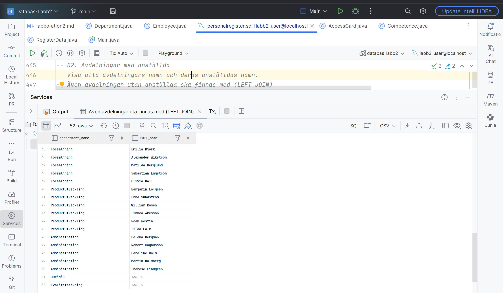
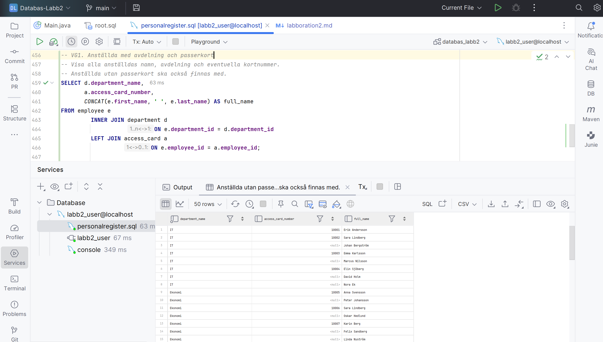
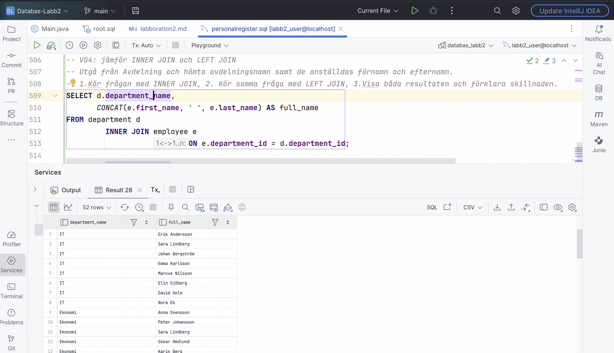
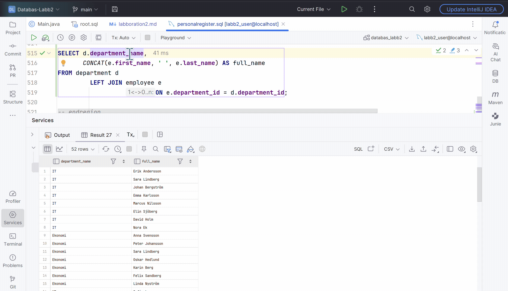
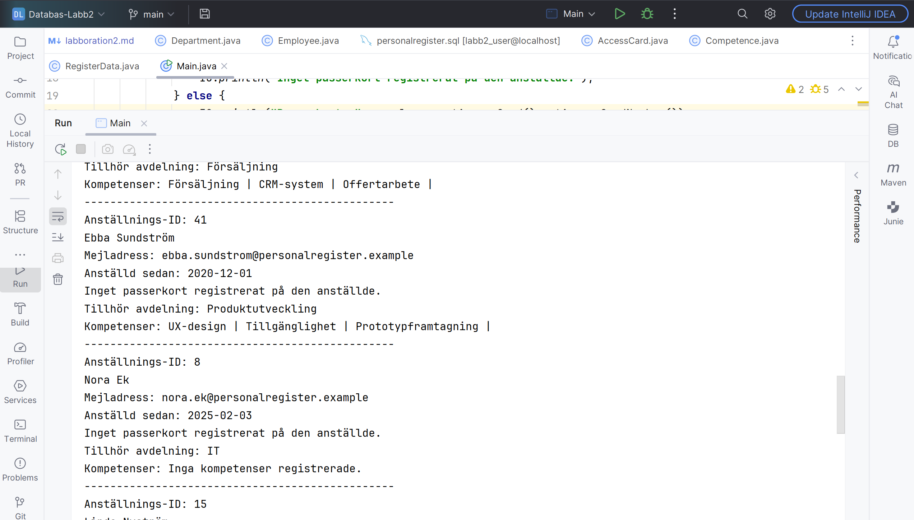
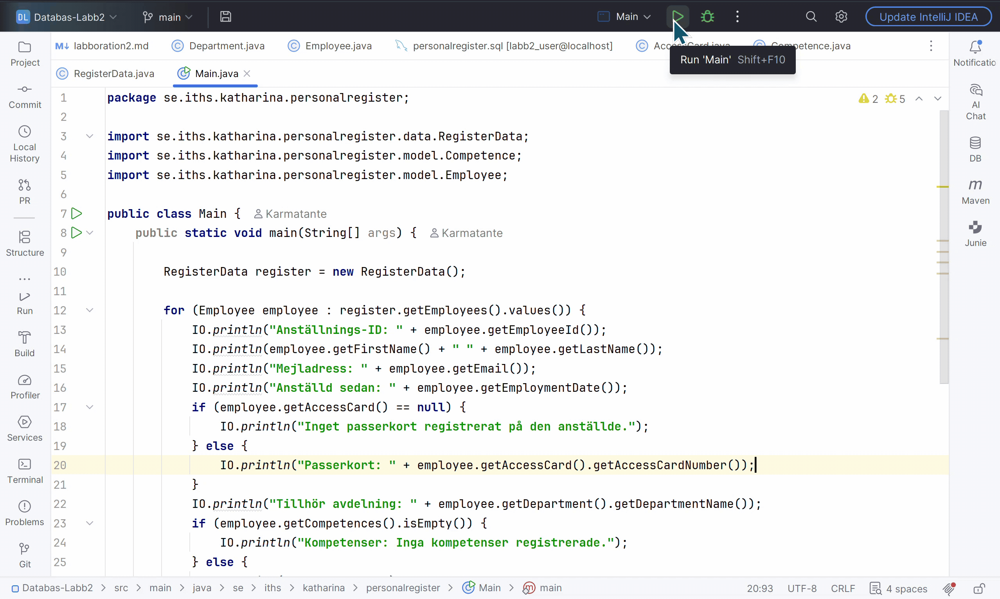

# Laboration 2 – Företagets personalregister

## 1. Projektöversikt

**Projekt:** `databas_labb2`  
**Databas:** `databas_labb2`  
**Databasanvändare:** `labb2_user` (lösenord dokumenteras genom 'Platshållare')

### 1.1 Databas och behörigheter

```sql
SELECT CURRENT_USER();
CREATE DATABASE databas_labb2;

CREATE USER 'labb2_user'@'localhost'
    IDENTIFIED BY 'PLATSHÅLLARE';

GRANT ALL PRIVILEGES
    ON databas_labb2.*
    TO 'labb2_user'@'localhost';

SHOW GRANTS FOR 'labb2_user'@'localhost';
```

```sql
SELECT CURRENT_USER(), DATABASE();
SHOW GRANTS; 
```

*Jag kontrollerade databasanslutningen i IntelliJ genom att köra `SELECT CURRENT_USER();` för att verifiera att jag
var ansluten som `labb2_user@localhost`.
Därefter använde jag `SELECT DATABASE();` för att kontrollera att den aktiva databasen var `databas_labb2`.
Slutligen körde jag `SHOW GRANTS;` för att kontrollera användarens behörigheter. Resultatet visade att `labb2_user` har
behörigheter inom `databas_labb2`, men inga globala databasbehörigheter.*


<table>
  <tr>
    <td width="320" valign="top">
      <a href="pictures/picture1.png">
        
      </a>
    </td>
    <td valign="top">
      <strong>Figur 1.</strong> Kontroll av användarbehörigheter
      i MySQL. Resultatet visar att <code>labb2_user</code>
      har fullständiga behörigheter till databasen
      <code>databas_labb2</code>, men inga motsvarande
      globala behörigheter till övriga databaser.
      <p><em>Klicka på bilden för att visa den i full storlek.</em></p>
    </td>
  </tr>
</table>


---

## 2. Datamodellering

### 2.1 Identifierade entiteter

| Entitet                 | Vad representerar den?                            | Varför behövs den?                                                                                                   |
|-------------------------|---------------------------------------------------|----------------------------------------------------------------------------------------------------------------------|
| **employee**            | *Företagets anställda*                            | För att hålla reda på alla anställda inom företaget.                                                                 |
| **department**          | *Företagets olika avdelningar*                    | För att registrera företagets avdelningar och kunna koppla anställda till rätt avdelning.                            |
| **access_card**         | *Passerkort som anställda kan få/ha*              | För att hålla reda på de passerkort som har getts ut.                                                                |
| **competence**          | *Kompetenser som Java, SQL och projektledning.*   | För att registrera vilka kompetenser som finns och deras beskrivningar, även om ingen anställd har kompetensen ännu. |
| **employee_competence** | *Kopplingen mellan en anställd och en kompetens.* | För att en anställd ska kunna ha flera kompetenser och samma kompetens kunna tillhöra flera anställda.               |

### 2.2 Attribut

| Entitet                 | Attribut             | Vad lagras?                       | Obligatoriskt? | Unikt?            |
|-------------------------|----------------------|-----------------------------------|----------------|-------------------|
| **employee**            | *employee_id*        | Unikt ID för den anställde        | Ja             | Ja                |
|                         | *first_name*         | Förnamn                           | Ja             | Nej               |
|                         | *last_name*          | Efternamn                         | Ja             | Nej               |
|                         | *email*              | E-postadress                      | Ja             | Ja                |
|                         | *employment_date*    | Anställningsdatum                 | Ja             | Nej               |
|                         | *department_id*      | ID för den anställdes avdelning   | Ja             | Nej               |
| **department**          | *department_id*      | Unikt ID för avdelningen          | Ja             | Ja                |
|                         | *department_name*    | Avdelningens namn                 | Ja             | Nej               |
|                         | *office_location*    | Kontorsort                        | Ja             | Nej               |
| **access_card**         | *access_card_id*     | Unikt internt ID för passerkortet | Ja             | Ja                |
|                         | *access_card_number* | Unikt kortnummer                  | Ja             | Ja                |
|                         | *issuance_date*      | Utfärdandedatum                   | Ja             | Nej               |
|                         | *expiry_date*        | Sista giltighetsdatum             | Ja             | Nej               |
|                         | *employee_id*        | ID för kortets innehavare         | Ja             | Ja                |
| **competence**          | *competence_id*      | Unikt ID för kompetensen          | Ja             | Ja                |
|                         | *competence_name*    | Kompetensens namn                 | Ja             | Ja                |
|                         | *description*        | Beskrivning av kompetensen        | Ja             | Nej               |
| **employee_competence** | *employee_id*        | ID för den anställde              | Ja             | Nej, inte enskilt |
|                         | *competence_id*      | ID för kompetensen                | Ja             | Nej, inte enskilt |

**Samtliga attribut har valts som obligatoriska för respektive registrerad post. Det innebär däremot inte att alla
relationer är obligatoriska. En anställd behöver exempelvis inte ha något passerkort, men varje registrerat passerkort
måste tillhöra exakt en anställd. En avdelning kan också existera utan anställda.**

### 2.2.1 Tillvägagångssätt och reflektion kring attributval

Jag utgick från verksamhetsbeskrivningen för att identifiera vilka attribut som behövdes för respektive entitet. Under
arbetets gång justerade jag modellen för att undvika onödig eller upprepad information, exempelvis departmentName i
employee och employee_count i department.

Jag valde datatyper och begränsningar utifrån verksamhetens krav och tog särskild hänsyn till vilka uppgifter som måste
vara obligatoriska eller unika. För VG utökade jag modellen med kompetenser och en kopplingstabell för att hantera
många-till-många-relationen.

### 2.3 Relationer och kardinalitet

| Entitet A           | Entitet B           | Kardinalitet | Obligatoriskt/valfritt | Motivering                                                             |
|---------------------|---------------------|--------------|------------------------|------------------------------------------------------------------------|
| department          | employee            | 0..N         | valfritt               | *En avdelning kan ha noll, en eller flera anställda*                   |
| employee            | department          | 1..1         | obligatoriskt          | *En anställd måste tillhöra exakt en avdelning.*                       |
| employee            | access_card         | 0..1         | valfritt               | *En anställd kan sakna passerkort eller ha högst ett.*                 |
| access_card         | employee            | 1..1         | obligatoriskt          | *Ett registrerat passerkort måste tillhöra exakt en anställd.*         |
| employee            | employee_competence | 0..N         | valfritt               | *En anställd kan ha flera kompetenskopplingar eller inga alls.*        |
| employee_competence | employee            | 1..1         | obligatoriskt          | *Varje koppling måste hänvisa till exakt en anställd.*                 |
| competence          | employee_competence | 0..N         | valfritt               | *En kompetens kan vara kopplad till flera anställda eller ingen alls.* |
| employee_competence | competence          | 1..1         | obligatoriskt          | *Varje koppling måste hänvisa till exakt en kompetens.*                |

Relationen mellan `employee` och `competence` är M:N. Kopplingstabellen `employee_competence` delar upp den i två 1:
N-relationer.

### 2.4 Nycklar, datatyper och begränsningar

| Tabell              | Kolumn             | Datatyp      | PK/FK   | Begränsningar   | Motivering                                                                                                                                                                                                                                                                                                                                        |
|---------------------|--------------------|--------------|---------|-----------------|---------------------------------------------------------------------------------------------------------------------------------------------------------------------------------------------------------------------------------------------------------------------------------------------------------------------------------------------------|
| employee            | employee_id        | INT          | PK      | AUTO_INCREMENT  | Varje anställd identifieras med ett numeriskt ID. PK eftersom varje anställd behöver kunna identifieras entydigt. Flera anställda kan ex. ha samma namn, men deras ID får aldrig vara samma. AUTO_INCREMENT så att MySQL tilldelar automatiskt nytt ID när en anställd registreras. NOT NULL behöver inte anges, då denna kolumn är primärnyckel. |
|                     | first_name         | VARCHAR(30)  |         | NOT NULL        | Förnamn lagras som text och måste anges.                                                                                                                                                                                                                                                                                                          |
|                     | last_name          | VARCHAR(30)  |         | NOT NULL        | Efternamn lagras som text och måste anges.                                                                                                                                                                                                                                                                                                        |
|                     | email              | VARCHAR(75)  |         | NOT NULL UNIQUE | E-postadressen måste finnas och vara unik för varje anställd.                                                                                                                                                                                                                                                                                     |
|                     | employment_date    | DATE         |         | NOT NULL        | Anställningsdatum lagras som datum utan klockslag.                                                                                                                                                                                                                                                                                                |
|                     | department_id      | INT          | FK      | NOT NULL        | FK → department.department_id   <br/>Kopplar den anställde till en befintlig avdelning. Flera anställda får tillhöra samma avdelning.                                                                                                                                                                                                             |
| department          | department_id      | INT          | PK      | AUTO_INCREMENT  | Varje avdelning identifieras med ett unikt numeriskt ID som genereras automatiskt. Primärnyckeln säkerställer att varje avdelning kan identifieras entydigt.                                                                                                                                                                                      |
|                     | departmentName     | VARCHAR(30)  |         | NOT NULL        | Avdelningens namn lagras som text och är obligatoriskt.                                                                                                                                                                                                                                                                                           |
|                     | office_location    | VARCHAR(30)  |         | NOT NULL        | Kontorsorten lagras som text och är obligatorisk. Värdet behöver inte vara unikt eftersom flera avdelningar kan finnas på samma ort.                                                                                                                                                                                                              |
| access_card         | access_card_id     | INT          | PK      | AUTO_INCREMENT  | Varje passerkort identifieras med ett unikt ID som genereras automatiskt.                                                                                                                                                                                                                                                                         |
|                     | access_card_number | INT          |         | NOT NULL UNIQUE | Varje passerkort måste ha ett unikt kortnummer.                                                                                                                                                                                                                                                                                                   |
|                     | issuance_date      | DATE         |         | NOT NULL        | Datumet då passerkortet utfärdades måste anges.                                                                                                                                                                                                                                                                                                   |
|                     | expiry_date        | DATE         |         | NOT NULL        | Sista giltighetsdatum måste anges för att kunna avgöra när kortet upphör att gälla.                                                                                                                                                                                                                                                               |
|                     | employee_id        | INT          | FK      | NOT NULL UNIQUE | FK → employee.employee_id <br/>Kopplar kortet till en befintlig anställd. NOT NULL säkerställer att kortet har en ägare och UNIQUE förhindrar att en anställd har flera registrerade kort.                                                                                                                                                        |
| competence          | competence_id      | INT          | PK      | AUTO_INCREMENT  | Varje kompetens identifieras med ett unikt ID som genereras automatiskt.                                                                                                                                                                                                                                                                          |
|                     | competence_name    | VARCHAR(75)  |         | NOT NULL UNIQUE | Kompetensens namn är obligatoriskt och får inte förekomma flera gånger.                                                                                                                                                                                                                                                                           |
|                     | description        | VARCHAR(500) |         | NOT NULL        | Beskrivningen lagras som text och ska finnas för varje kompetens.                                                                                                                                                                                                                                                                                 |
| employee_competence | employee_id        | INT          | PK + FK | NOT NULL        | Refererar till employee.employee_id och identifierar den anställde i kopplingen.                                                                                                                                                                                                                                                                  |
|                     | competence_id      | INT          | PK + FK | NOT NULL        | Refererar till competence.competence_id och identifierar kompetensen i kopplingen.                                                                                                                                                                                                                                                                |

**Regler som modellen måste säkerställa:**

- **Regel 1** – Anställda och avdelningar: Varje anställd måste tillhöra exakt en befintlig avdelning, men en avdelning
  får
  sakna anställda. Detta säkerställs genom att employee.department_id är NOT NULL och FOREIGN KEY som refererar till
  department.department_id. E-postadressen måste dessutom vara unik, vilket säkerställs med UNIQUE på employee.email.

- **Regel 2** – Passerkort: En anställd får ha högst ett passerkort men behöver inte ha något. Varje registrerat
  passerkort
  måste tillhöra exakt en anställd. Detta säkerställs genom att access_card.employee_id är NOT NULL, UNIQUE och FOREIGN
  KEY. En anställd utan passerkort saknar helt enkelt en motsvarande rad i access_card. Även kortnumret måste vara
  unikt, vilket säkerställs med UNIQUE på access_card_number.

- **Regel 3** – Kompetenser: En anställd kan ha flera kompetenser eller inga alls, och samma kompetens kan finnas
  hos
  flera anställda. Detta hanteras genom kopplingstabellen employee_competence, där employee_id och competence_id
  tillsammans bildar en sammansatt primärnyckel. Båda är även främmande nycklar. På så sätt förhindras dubbla
  kopplingar, samtidigt som anställda och kompetenser kan registreras utan kopplingar. Kompetensnamnet måste vara unikt,
  vilket säkerställs med UNIQUE på competence.competence_name.

### 2.5 Datamodell – bild


*Figur 2. ER-diagram över personalregistrets databasmodell, inklusive kompetenshantering för VG.*

ER-diagrammet ger en översikt över databasens struktur och visar hur de fem tabellerna är kopplade till varandra. I
diagrammet framgår tabellernas attribut, datatyper, primärnycklar (PK), främmande nycklar (FK) och relationernas
kardinalitet.

För att behålla diagrammet tydligt och lättläst har jag valt att inte visa alla begränsningar direkt i det.
Begränsningar som `NOT NULL`, `UNIQUE` och `AUTO_INCREMENT` finns i stället dokumenterade i tabellen under avsnitt 2.4 –
Nycklar, datatyper och begränsningar, tillsammans med motiveringar till mina val.

På så sätt kompletterar ER-diagrammet och tabellen varandra: diagrammet visar hur databasen är uppbyggd, medan tabellen
beskriver de regler som ska säkerställa dataintegriteten.

---

## 3. SQL-implementation och testdata

### 3.1 Tabeller och SQL-filer

**SQL-filer:**

- [`SQL-files/root.sql`](SQL-files/root.sql) – skapar databasen, MySQL-användaren och tilldelar behörigheter.
- [`SQL-files/personalregister.sql`](SQL-files/personalregister.sql) – skapar tabellerna och lägger in testdata samt
  innehåller SQL-frågorna.

Jag skapade tabellerna i ordningen `department`, `employee`, `access_card`, `competence` och slutligen
`employee_competence`. Ordningen valdes utifrån tabellernas beroenden. Exempelvis måste `department` finnas innan
`employee` kan skapas med en främmande nyckel som refererar till avdelningen. På samma sätt behöver både `employee` och
`competence` finnas innan kopplingstabellen `employee_competence` skapas.

De fullständiga `CREATE TABLE`-kommandona finns i `SQL-files/personalregister.sql`.

### 3.2 Testdata

Jag har skapat fiktiv testdata med **10 avdelningar, 50 anställda, 25 passerkort och 68 kompetenser**. Testdatan är
utformad för att täcka verksamhetens regler och ge varierade resultat vid SQL-frågor med olika typer av JOIN.

De 50 anställda är fördelade mellan åtta avdelningar, medan Juridik och Kvalitetssäkring saknar personal. Av de
anställda har 25 passerkort och 25 saknar passerkort. Jag har också inkluderat två personer med samma för- och efternamn
men olika e-postadresser för att visa att namn inte behöver vara unika.

Jag har lagt till **153 kompetenskopplingar**. De flesta anställda har flera kompetenser, och vissa
kompetenser delas av personer från olika avdelningar. Fem anställda saknar registrerade kompetenser och fyra kompetenser
saknar kopplade anställda. Detta gör det möjligt att testa många-till-många-relationen och kontrollera att även poster
utan kopplingar hanteras korrekt.

**Användning av AI**

Den fiktiva testdatan har tagits fram med hjälp av ChatGPT. AI har använts för att generera namn, avdelningar,
kompetenser, beskrivningar och tillhörande testvärden. Jag har själv arbetat med databasmodellen, skapat tabellerna i
MySQL och kontrollerat att testdatan fungerar med databasens relationer och begränsningar.

Samtliga `INSERT INTO`-kommandon finns i `SQL-files/personalregister.sql`.

---

## 4. SQL-frågor

### 4.1 G1 – Anställda med avdelning (INNER JOIN)

**Vad frågan ska visa:** Anställdas förnamn, efternamn och avdelningsnamn.

**SQL-fråga:** [G1 – INNER JOIN](SQL-files/personalregister.sql#L438-L443)

```sql
SELECT e.first_name, e.last_name, d.departmentName
FROM employee e
         INNER JOIN department d
                    ON e.department_id = d.department_id;
```

Frågan visar varje anställds förnamn, efternamn och vilken avdelning personen arbetar på. Resultatet innehåller totalt
50 rader.

`INNER JOIN` fungerar genom att jämföra `department_id` i tabellen `employee` med `department_id` i tabellen
`department`. När värdena är lika kopplas den anställda ihop med rätt avdelning, och avdelningens namn kan visas
tillsammans med personens namn.

Eftersom `INNER JOIN` bara tar med rader där det finns en matchning visas inte avdelningar som saknar anställda. Alla 50
anställda kommer däremot med eftersom varje anställd har ett `department_id` som motsvarar en befintlig avdelning.

<table>
  <tr>
    <td width="620" valign="top">
      <a href="pictures/G1.png">
        
      </a>
    </td>
    <td valign="top">
      <strong>Figur 3.</strong> Resultat av G1 – INNER JOIN mellan
      employee och department. Frågan visar 50 anställda med
      förnamn, efternamn och tillhörande avdelning.
      <p><em>Klicka på bilden för att visa den i full storlek.</em></p>
    </td>
  </tr>
</table>

### 4.2 G2 – Alla avdelningar med anställda (LEFT JOIN)

**Vad frågan ska visa:** Alla avdelningar och deras anställda, även avdelningar utan personal.

**SQL-fråga:** [G2 – LEFT JOIN](SQL-files/personalregister.sql#L446-L453)

```sql
SELECT d.departmentName,
       CONCAT(e.first_name, ' ', e.last_name) AS full_name
FROM department d
         LEFT JOIN employee e
                   ON e.department_id = d.department_id;
```

Frågan använder `LEFT JOIN` för att koppla samman `department` och `employee` genom deras gemensamma `department_id`.
Eftersom `department` står till vänster i kopplingen visas samtliga avdelningar, oavsett om de har anställda eller inte.

Resultatet innehåller 52 rader: 50 anställda och två avdelningar utan personal. Juridik och Kvalitetssäkring visas med
`NULL` i kolumnen `full_name`, eftersom det inte finns några matchande anställda.

Jag har använt `CONCAT()` för att visa för- och efternamn i samma kolumn.

<table>
  <tr>
    <td width="620" valign="top">
      <a href="pictures/G2.png">
        
      </a>
    </td>
    <td valign="top">
      <strong>Figur 4.</strong> Resultat av G2 – LEFT JOIN,
      inklusive avdelningarna Juridik och Kvalitetssäkring
      som saknar anställda och därför visas med
      <code>NULL</code> i namnkolumnen.
      <p><em>Klicka på bilden för att visa den i full storlek.</em></p>
    </td>
  </tr>
</table>

### 4.3 VG1 – Anställda med avdelning och eventuellt passerkort

**SQL-fråga:** [VG1 – Anställda med avdelning och passerkort](SQL-files/personalregister.sql#L456-L466)

```sql
SELECT d.departmentName,
       a.access_card_number,
       CONCAT(e.first_name, ' ', e.last_name) AS full_name
FROM employee e
         INNER JOIN department d
                    ON e.department_id = d.department_id
         LEFT JOIN access_card a
                   ON e.employee_id = a.employee_id;
```

Frågan använder INNER JOIN för att koppla varje anställd till rätt avdelning genom department_id.
Eftersom alla anställda måste tillhöra en befintlig avdelning kommer samtliga 50 anställda med i resultatet.

Därefter används LEFT JOIN för att koppla de anställda till tabellen access_card genom employee_id. Eftersom employee
står till vänster behålls alla anställda, även om de inte har något passerkort.

Resultatet innehåller därför 50 rader. De 25 anställda som har passerkort får sitt kortnummer visat, medan de övriga 25
visas med NULL i kolumnen access_card_number.

<table>
  <tr>
    <td width="620" valign="top">
      <a href="pictures/VG1.png">
        
      </a>
    </td>
    <td valign="top">
      <strong>Figur 5.</strong> Resultat av VG1 – JOIN mellan
      employee, department och access_card.
      Frågan visar alla 50 anställda med deras avdelningar
      och eventuella passerkort. De 25 anställda som saknar
      passerkort visas med <code>NULL</code> som kortnummer.
      <p><em>Klicka på bilden för att visa den i full storlek.</em></p>
    </td>
  </tr>
</table>

### 4.4 VG2 – Avdelningar, anställda och eventuella passerkort

**SQL-fråga:** [VG2 – Avdelningar, anställda och eventuella passerkort](SQL-files/personalregister.sql#L468-L478)

```sql
SELECT d.departmentName,
       a.access_card_number,
       CONCAT(e.first_name, ' ', e.last_name) AS full_name
FROM department d
         LEFT JOIN employee e
                   ON e.department_id = d.department_id
         LEFT JOIN access_card a
                   ON e.employee_id = a.employee_id;
```

Frågan använder två `LEFT JOIN` för att visa alla avdelningar, deras anställda och eventuella passerkort.

Jag utgår från `department` för att även få med avdelningar utan personal. Den första kopplingen hämtar anställda via
`department_id`, medan den andra hämtar eventuella passerkort via `employee_id`.

Eftersom båda kopplingarna använder `LEFT JOIN` behålls även rader utan matchning. Resultatet visar därför **52 rader**,
där saknade uppgifter visas som `NULL`. `CONCAT()` används för att kombinera för- och efternamn.

<table>
  <tr>
    <td width="620" valign="top">
      <a href="pictures/VG2.png">
        
      </a>
    </td>
    <td valign="top">
      <strong>Figur 6.</strong> Resultat av VG2 – LEFT JOIN
      mellan department, employee och access_card.
      Frågan visar alla 10 avdelningar och deras anställda
      med eventuella passerkort. Juridik och Kvalitetssäkring
      saknar anställda och visas därför med
      <code>NULL</code> i både namn- och kortnummerkolumnen.
      <p><em>Klicka på bilden för att visa den i full storlek.</em></p>
    </td>
  </tr>
</table>

### 4.5 VG3 – En anställds samlade uppgifter

**SQL-fråga:** [VG3 – Anställda med avdelning, passerkort och kompetenser](SQL-files/personalregister.sql#L483-L494)

```sql
SELECT e.employee_id,
       d.departmentName,
       e.employment_date,
       COALESCE(
               CAST(a.access_card_number AS CHAR),
               'Inget passerkort registrerat'
       )                                      AS access_card,
       CONCAT(e.first_name, ' ', e.last_name) AS full_name,
       COALESCE(
               CONCAT(c.competence_name, ': ', c.description),
               'Inga kompetenser registrerade för den anställde'
       )                                      AS competences
FROM employee e
         INNER JOIN department d
                    ON e.department_id = d.department_id
         LEFT JOIN access_card a
                   ON e.employee_id = a.employee_id
         LEFT JOIN employee_competence ec
                   ON e.employee_id = ec.employee_id
         LEFT JOIN competence c
                   ON ec.competence_id = c.competence_id
WHERE e.employee_id = 8;
```

Jag har skapat två SQL-frågor för att kontrollera hur databasen hanterar anställda med och utan passerkort och
registrerade kompetenser. Frågorna är identiska förutom `WHERE`-villkoret, som väljer vilken anställd som ska visas.

Frågorna utgår från `employee` och visar anställnings-ID, namn, anställningsdatum, avdelning, passerkort och
kompetenser. `INNER JOIN` används för att koppla den anställde till sin avdelning, eftersom varje anställd måste
tillhöra en avdelning.

För passerkort och kompetenser används `LEFT JOIN`, vilket innebär att den anställde behålls i resultatet även om
matchande uppgifter saknas. Kompetenserna hämtas via kopplingstabellen `employee_competence`, som hanterar
många-till-många-relationen mellan anställda och kompetenser.

Jag testar först `employee_id = 1`, som har passerkort och flera kompetenser. Personen visas på flera resultatrader
eftersom varje kompetens ger en egen rad. Det innebär inte att personen är registrerad flera gånger i databasen.

Därefter testar jag `employee_id = 8`, som saknar både passerkort och registrerade kompetenser. Personen visas ändå tack
vare `LEFT JOIN`. Med hjälp av `COALESCE()` ersätter jag `NULL` med förklarande texter, exempelvis *Inget passerkort
registrerat* och *Inga kompetenser registrerade för den anställde*. `CAST()` används för att omvandla kortnumret till
text innan det hanteras av `COALESCE()`.

`COALESCE()` och `CAST()` är två SQL-funktioner som jag hittade när jag undersökte hur jag kunde hantera och presentera
`NULL`-värden på ett tydligare sätt. Med `COALESCE()` kan jag ersätta `NULL` med en förklarande text, medan `CAST()`
används för att omvandla kortnumret från heltal till text.

De två testerna visar att frågorna hanterar valfria relationer korrekt och att anställda inte försvinner ur resultatet
när passerkort eller kompetenser saknas.


<table>
  <tr>
    <td width="620" valign="top">
      <a href="pictures/VG3.png">
        
      </a>
    </td>
    <td valign="top">
      <strong>Figur 7.</strong> Resultat för
      <code>employee_id = 1</code> (Erik Andersson).
      Frågan visar anställnings-ID, namn, anställningsdatum,
      avdelning, passerkort och registrerade kompetenser.
      Eftersom den anställde har flera kompetenser
      visas en resultatrad per kompetens.
      <p><em>Klicka på bilden för att visa den i full storlek.</em></p>
    </td>
  </tr>
  <tr>
    <td width="620" valign="top">
      <a href="pictures/VG3-2.png">
        
      </a>
    </td>
    <td valign="top">
      <strong>Figur 8.</strong> Resultat för
      <code>employee_id = 8</code> (Nora Ek).
      Den anställde visas trots att passerkort och
      registrerade kompetenser saknas.
      Med hjälp av <code>COALESCE()</code> visas
      förklarande texter i stället för <code>NULL</code>.
      Detta visar att <code>LEFT JOIN</code> behåller
      den anställde även när matchande uppgifter saknas.
      <p><em>Klicka på bilden för att visa den i full storlek.</em></p>
    </td>
  </tr>
</table>

### 4.6 VG4 – Jämförelse mellan INNER JOIN och LEFT JOIN

**SQL-fråga:** [VG4 – Jämförelse INNER JOIN och LEFT JOIN](SQL-files/personalregister.sql#L506-L526)

```sql
SELECT d.departmentName,
       CONCAT(e.first_name, ' ', e.last_name) AS full_name
FROM department d
         INNER JOIN employee e
                    ON e.department_id = d.department_id;

SELECT d.departmentName,
       CONCAT(e.first_name, ' ', e.last_name) AS full_name
FROM department d
         LEFT JOIN employee e
                   ON e.department_id = d.department_id;
```

<table>
  <tr>
    <td width="920" valign="top">
      <a href="pictures/VG4-1.gif">
        
      </a>
    </td>
    <td valign="top">
      <strong>Figur 9.</strong> Resultat med
      <code>INNER JOIN</code>.
      Animationen visar hur tabellerna <code>department</code>
      och <code>employee</code> kopplas samman med hjälp av
      deras gemensamma <code>department_id</code>.
      Med hjälp av <code>CONCAT()</code> sammanfogas de
      anställdas förnamn och efternamn till ett fullständigt
      namn i kolumnen <code>full_name</code>.
      Resultatet innehåller 50 rader och visar endast
      avdelningar som har minst en anställd.
      Avdelningar utan anställda visas inte, eftersom
      <code>INNER JOIN</code> kräver en matchning mellan
      båda tabellerna.
      <p><em>Öppna GIF-filen i en webbläsare för att
      visa animationen i originalstorlek.</em></p>
    </td>
  </tr>
  <tr>
    <td width="920" valign="top">
      <a href="pictures/VG4-2.gif">
        
      </a>
    </td>
    <td valign="top">
      <strong>Figur 10.</strong> Resultat med
      <code>LEFT JOIN</code>.
      Animationen visar samma SQL-fråga, men med
      <code>LEFT JOIN</code> i stället för
      <code>INNER JOIN</code>.
      Resultatet innehåller 52 rader, eftersom samtliga
      avdelningar från tabellen <code>department</code>
      inkluderas, även när det inte finns några matchande
      anställda i tabellen <code>employee</code>.
      Längst ned i resultatet visas avdelningarna Juridik
      och Kvalitetssäkring, som saknar anställda.
      För dessa avdelningar visas <code>NULL</code>
      i kolumnen <code>full_name</code>.
      Detta illustrerar den grundläggande skillnaden
      mellan <code>INNER JOIN</code> och
      <code>LEFT JOIN</code>.
      <p><em>Öppna GIF-filen i en webbläsare för att
      visa animationen i originalstorlek.</em></p>
    </td>
  </tr>
</table>

#### Jämförelse mellan INNER JOIN och LEFT JOIN ####

*Varför finns avdelningar utan anställda kvar med LEFT JOIN?*

LEFT JOIN returnerar samtliga rader från den vänstra tabellen (department), även om det inte finns någon matchande rad i
den högra tabellen (employee). Eftersom avdelningarna finns registrerade i tabellen department visas de i resultatet,
trots att inga anställda är kopplade till dem via department_id.

*Vad visas i kolumnerna för anställda på dessa rader?*

I kolumnerna som hämtar information från tabellen employee visas NULL, eftersom det inte finns någon matchande anställd.
NULL innebär här att det saknas ett värde, inte att värdet är noll eller en tom textsträng. Information som hämtas från
tabellen department, exempelvis avdelningens namn, visas däremot fortfarande.

*Vilken avdelning försvinner med INNER JOIN?*

I min databas försvinner två avdelningar, Juridik och Kvalitetssäkring, när jag använder INNER JOIN. Anledningen är att
dessa avdelningar inte har några registrerade anställda. Det finns alltså inga rader i tabellen employee vars
department_id matchar dessa avdelningars department_id i tabellen department. Eftersom INNER JOIN kräver en matchning
mellan båda tabellerna utesluts dessa avdelningar från resultatet.

*Slutsats:*

Med INNER JOIN får jag 50 resultatrader, medan jag med LEFT JOIN får 52 resultatrader. De två extra raderna
representerar avdelningarna Juridik och Kvalitetssäkring, där avdelningsnamnet visas i kolumnen departmentName, men
värdet i kolumnen full_name är NULL.

Vilken typ av JOIN som är lämpligast beror därför på vilken information jag vill få fram. Om jag endast vill visa
avdelningar med registrerade anställda är INNER JOIN lämplig. Om jag däremot vill få en fullständig överblick över
företagets samtliga avdelningar, även de som för närvarande saknar anställda, är LEFT JOIN det bättre alternativet.

---

## 5. Java-modell

### 5.1 Modellklasser

I Java-applikationen har jag skapat fyra modellklasser som motsvarar databasens entiteter. Därutöver har jag skapat två
klasser för att hantera testdata och köra programmet.

| Java-klass       | Motsvarande entitet       | Viktiga egenskaper                                                                                                                          |
|------------------|---------------------------|---------------------------------------------------------------------------------------------------------------------------------------------|
| **Department**   | department                | Avdelnings-ID, avdelningsnamn och kontorsort.                                                                                               |
| **Employee**     | employee                  | Anställnings-ID, förnamn, efternamn, mejladress, anställningsdatum samt referenser till avdelning, passerkort och en lista med kompetenser. |
| **AccessCard**   | access_card               | Passerkorts-ID, unikt kortnummer, utfärdandedatum, giltighetsdatum och referens till den anställde.                                         |
| **Competence**   | competence                | Kompetens-ID, kompetensnamn och beskrivning.                                                                                                |
| **RegisterData** | Ingen direkt motsvarighet | Skapar och lagrar testdata med hjälp av Map och kopplar samman anställda med avdelningar, passerkort och kompetenser.                       |
| **Main**         | Ingen direkt motsvarighet | Innehåller programmets main()-metod och skriver ut information om anställda och deras relationer i konsolen.                                |

Relationen mellan `employee` och `competence` representeras i Java genom `List<Competence>` i klassen `Employee`. Därför
behövs
ingen separat Java-klass för kopplingstabellen `employee_competence`. Flera anställda kan referera till samma
`Competence`-objekt.

### 5.2 Relationer i Java – G

I Java har jag representerat relationerna mellan anställda, avdelningar och passerkort genom objektreferenser i stället
för främmande nycklar.

Klassen `Employee` innehåller ett fält av typen `Department`. Varje anställd får en referens till ett befintligt
avdelningsobjekt när den skapas. Genom `getDepartment()` kan jag därför komma åt den anställdes avdelning och exempelvis
hämta avdelningsnamnet med `getDepartmentName()`.

Relationen till `AccessCard` fungerar på liknande sätt, men är valfri. En anställd kan ha ett passerkort eller sakna
ett. Om personen saknar passerkort är fältet `accessCard` lika med `null`. I `Main` kontrollerar jag därför om
passerkortet finns innan jag försöker hämta kortnumret.

Jag har även en referens från `AccessCard` tillbaka till `Employee`.

### 5.3 Kompetenser i Java

Jag har utökat klassen `Employee` med en `List<Competence>`. Jag valde en lista eftersom en anställd kan ha flera
kompetenser, men också sakna registrerade kompetenser helt.

Kompetenserna skapas som separata objekt i klassen `RegisterData` och lagras i en `Map<Integer, Competence>`, där
kompetens-ID används som nyckel. När jag tilldelar kompetenser till anställda hämtar jag befintliga objekt från denna
Map och lägger till referenserna i respektive anställds lista.

Det innebär att flera anställda kan hänvisa till samma kompetensobjekt. Exempelvis har både Erik Andersson och Johan
Bergström kompetensen SQL, och båda refererar till samma `Competence`-objekt.

I relationsdatabasen hanteras denna många-till-många-relation genom kopplingstabellen `employee_competence`. I Java
representeras den i stället genom listan med objektreferenser.

Jag har också registrerat tre kompetenser som inte tilldelas någon anställd. Det visar att en kompetens kan existera i
modellen utan att vara kopplad till en anställd.

### 5.4 Fiktiva objekt och utskrifter

Jag har skapat fiktiva testobjekt direkt i Java-koden genom klassen `RegisterData`. Testdatan utgår från samma uppgifter
som jag tidigare registrerade i MySQL.

I Java-applikationen har jag valt att använda ett urval av databasens testdata: 10 avdelningar, 15 anställda, 7
passerkort och 34 kompetenser. I databasen `databas_labb2` finns 10 avdelningar, 50 anställda, 25 passerkort och 68
kompetenser.

Jag använder `Map<Integer, Department>`,`Map<Integer, Employee>` och `Map<Integer, Competence>` för att lagra objekten
och kunna hämta dem med deras ID.

När ett `RegisterData`-objekt skapas körs metoderna som registrerar avdelningarna, skapar de anställda, tilldelar
passerkort och kopplar kompetenser till de anställda. Avdelningarna skapas först eftersom de anställda behöver kunna
referera till befintliga avdelningsobjekt. Samma följd som i databasen efterlevdes alltså.

I klassen `Main` använder jag en `for-each`-loop för att gå igenom samtliga anställda och skriva ut deras uppgifter i
konsolen.

Utskriften visar anställnings-ID, namn, mejladress, anställningsdatum, avdelning, eventuellt passerkort och registrerade
kompetenser.

Programmet hanterar även anställda som saknar passerkort eller kompetenser. Om passerkortet saknas visas ett meddelande
i stället för kortnummer. Om kompetenslistan är tom visas texten *Inga kompetenser registrerade.*

Konsolutskriften dokumenteras nedan med en GIF-animation som visar samtliga 15 anställda och skärmdumpar.

<table>
  <tr>
    <td width="620" valign="top">
      <a href="pictures/JavaResult2.png">
        
      </a>
    </td>
    <td valign="top">
      <p>
        <strong>Figur 11.</strong>
        Konsolutskrift från Java-applikationen.
      </p>
      <p>
        Programmet visar anställdas ID, namn,
        mejladress och anställningsdatum samt
        tillhörande avdelning, eventuellt
        passerkort och registrerade kompetenser.
      </p>
      <p>
        <em>Klicka på bilden för att visa den
        i full storlek.</em>
      </p>
    </td>
  </tr>
  <tr>
    <td width="620" valign="top">
      <a href="pictures/JavaResult3.png">
        
      </a>
    </td>
    <td valign="top">
      <p>
        <strong>Figur 12.</strong>
        Fortsättning av Java-applikationens
        konsolutskrift.
      </p>
      <p>
        Utskriften demonstrerar hur programmets
        objekt och relationer används för att
        visa personalregistrets information.
        Programmet hanterar även anställda som
        saknar passerkort eller kompetenser.
      </p>
      <p>
        <em>Klicka på bilden för att visa den
        i full storlek.</em>
      </p>
    </td>
  </tr>
</table>

<table>
  <tr>
    <td width="920" valign="top">
      <a href="pictures/JavaResult.gif">
        
      </a>
    </td>
    <td valign="top">
      <p>
        <strong>Figur 13.</strong>
        Animerad demonstration av Java-applikationens
        fullständiga konsolutskrift.
      </p>
      <p>
        GIF-animationen visar samtliga 15 anställda
        med anställnings-ID, namn, mejladress,
        anställningsdatum och avdelning samt
        eventuella passerkort och kompetenser.
      </p>
      <p>
        Demonstrationen visar hur relationerna mellan
        Employee, Department, AccessCard och Competence
        fungerar i Java-modellen. Även anställda utan
        passerkort eller registrerade kompetenser visas.
      </p>
      <p>
        <em>Klicka på animationen för att visa
        den i originalstorlek.</em>
      </p>
    </td>
  </tr>
</table>

### 5.5 Så körs programmet

Java-applikationen startas genom att köra `Main.java` i IntelliJ IDEA. Klassen innehåller programmets `main()`-metod,
som är startpunkten för applikationen.

När programmet körs skapas ett objekt av `RegisterData`. Klassens konstruktor anropar metoderna som skapar avdelningar,
anställda, passerkort och kompetenser samt kopplar ihop objekten.

Därefter går `Main` igenom de registrerade anställda med en `for-each`-loop och skriver ut deras uppgifter i konsolen.


