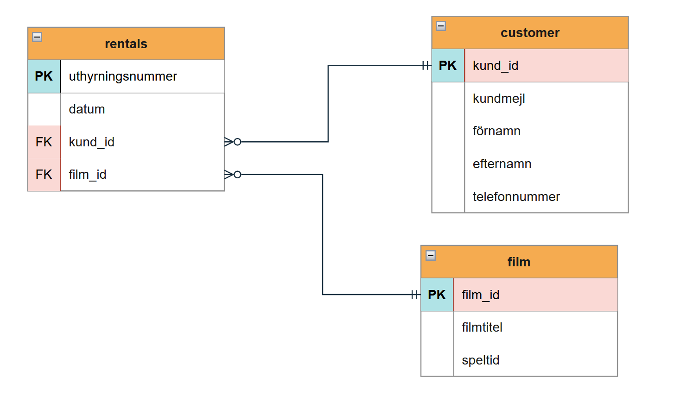

# Laboration 2 – Del 2: Normalisering

## 1. Ursprungligt underlag

| uthyrningsnummer | datum      | kunduppgifter                            | filmtitel   | speltid |
|------------------|------------|------------------------------------------|-------------|---------|
| 101              | 2026-11-01 | Anna Berg, anna@example.com, 070-1111111 | Stjärnresan | 119 min |
| 102              | 2026-11-02 | Erik Lind, erik@example.com, 070-2222222 | Månjakten   | 99 min  |
| 103              | 2026-11-05 | Anna Berg, anna@example.com, 070-1111111 | Månjakten   | 99 min  |

## 2. Första normalformen (1NF)

Kolumnen `kunduppgifter` har delats upp i fyra separata kolumner: `förnamn`, `efternamn`, `kundmejl` och
`telefonnummer`. Speltiden anges som ett numeriskt värde i minuter.

Varje cell innehåller nu ett atomärt värde, vilket gör det enklare att söka, filtrera och uppdatera enskilda uppgifter.
Det finns dock fortfarande redundans i kund- och filmuppgifterna.

Anna Bergs kunduppgifter förekommer i både uthyrning 101 och 103. Filmuppgifterna för Månjakten förekommer i både
uthyrning 102 och 103. Om någon av dessa uppgifter ändras måste ändringen därför göras på flera rader, vilket medför en
risk för inkonsekventa uppgifter.

| uthyrningsnummer (PK) | datum      | förnamn | efternamn | kundmejl         | telefonnummer | filmtitel   | speltid |
|-----------------------|------------|---------|-----------|------------------|---------------|-------------|---------|
| 101                   | 2026-11-01 | Anna    | Berg      | anna@example.com | 070-1111111   | Stjärnresan | 119     |
| 102                   | 2026-11-02 | Erik    | Lind      | erik@example.com | 070-2222222   | Månjakten   | 99      |
| 103                   | 2026-11-05 | Anna    | Berg      | anna@example.com | 070-1111111   | Månjakten   | 99      |

## 3. Andra normalformen (2NF)

Tabellen uppfyller redan andra normalformen eftersom den uppfyller 1NF och kandidatnyckeln `uthyrningsnummer` endast
består av en kolumn.

Det finns därför inga partiella beroenden och ingen förändring av tabellstrukturen behövs.

## 4. Tredje normalformen (3NF)

Tabellen innehåller fortfarande transitiva beroenden, vilket innebär att vissa attribut är indirekt beroende av
primärnyckeln.

**Transitiva beroenden:**

- `uthyrningsnummer` → `kundmejl` → `förnamn`, `efternamn`, `telefonnummer`
- `uthyrningsnummer` → `filmtitel` → `speltid`

Dessa beroenden leder till redundans eftersom samma uppgifter lagras på flera rader. Om en kund exempelvis byter
telefonnummer måste uppgiften uppdateras på samtliga rader där kunden förekommer. Det ökar risken för inkonsekventa
uppgifter och försämrad dataintegritet.

Jag har därför delat upp tabellen i tre separata tabeller: `rentals`, `customer` och `film`. Kund- och filmuppgifterna
lagras nu på ett enda ställe, vilket eliminerar de transitiva beroendena och minskar redundansen. Tabellerna uppfyller
därmed tredje normalformen.

Främmande nycklar som kund_id och film_id kan fortfarande förekomma på flera rader i tabellen rentals. Exempelvis
förekommer kund_id 1 i både uthyrning 101 och 103. Detta är inte problematisk redundans eftersom ID-numren används för
att referera till samma kundpost i kundtabellen. Kundens namn, e-postadress och telefonnummer lagras fortfarande endast
på ett ställe. Samma princip gäller för filmuppgifterna.

### 4.1 Tabell: rentals (Uthyrningar)

| uthyrningsnummer (PK) | datum      | kund_id (FK) | film_id (FK) |
|-----------------------|------------|--------------|--------------|
| 101                   | 2026-11-01 | 1            | 1            |
| 102                   | 2026-11-02 | 2            | 2            |
| 103                   | 2026-11-05 | 1            | 2            |

### 4.2 Tabell: customer (Kunder)

| kund_id (PK) | kundmejl         | förnamn | efternamn | telefonnummer |
|--------------|------------------|---------|-----------|---------------|
| 1            | anna@example.com | Anna    | Berg      | 070-1111111   |
| 2            | erik@example.com | Erik    | Lind      | 070-2222222   |

### 4.3 Tabell: film (Filmer)

| film_id (PK) | filmtitel   | speltid |
|--------------|-------------|---------|
| 1            | Stjärnresan | 119     |
| 2            | Månjakten   | 99      |

## 5. Nycklar och relationer

### Primärnycklar (PK)

`uthyrningsnummer` identifierar varje uthyrning unikt. Samma kund kan göra flera uthyrningar, men varje uthyrning får
ett eget uthyrningsnummer.

Enligt uppgiftens förutsättningar identifierar `kundmejl` varje kund unikt. I verkligheten kan en kund dock ha flera
e-postadresser och använda olika e-postadresser vid olika uthyrningstillfällen. Om e-postadressen används som
primärnyckel finns det en risk att samma kund registreras som två olika kunder.

En kund kan dessutom byta e-postadress, vilket skulle innebära att primärnyckeln behöver ändras.

Jag har därför valt att använda `kund_id` som primärnyckel. Kunden får ett unikt ID som inte behöver ändras när
kundens e-postadress ändras.

Enligt uppgiftens förutsättningar identifierar `filmtitel` varje film unikt. I verkligheten kan det dock finnas flera
olika filmer med samma titel, exempelvis originalfilmer och nyinspelningar såsom t.ex. King Kong.

Eftersom en primärnyckel måste vara unik skulle det inte vara möjligt att registrera två olika filmer med samma titel
om `filmtitel` används som primärnyckel.

Jag har därför valt att använda `film_id` som primärnyckel. Varje film får ett eget unikt ID, vilket gör det möjligt
att registrera olika filmer även om de har samma titel.

För att även säkerställa uppgiftens förutsättningar kan kundmejl och filmtitel definieras med en UNIQUE-begränsning i
respektive tabell.

### Främmande nycklar (FK)

- `rentals.kund_id` hänvisar till `customer.kund_id`.
- `rentals.film_id` hänvisar till `film.film_id`.

### Relationer

**customer – rentals (1:N)**

En kund kan förekomma i noll eller flera uthyrningar, medan varje uthyrning måste vara kopplad till exakt en kund. En
nyregistrerad kund behöver inte ha gjort någon uthyrning ännu.

**film – rentals (1:N)**

En film kan förekomma i noll eller flera uthyrningar, medan varje uthyrning måste vara kopplad till exakt en film. En
nyregistrerad film behöver inte ha hyrts ut ännu.

Om strukturen senare implementeras i SQL bör båda främmande nycklarna också vara NOT NULL för att säkerställa att varje
uthyrning har en kund och en film.

All information från den ursprungliga tabellen finns kvar och kan återskapas genom att sammanfoga tabellerna med hjälp
av deras nycklar.

### ER-diagram

